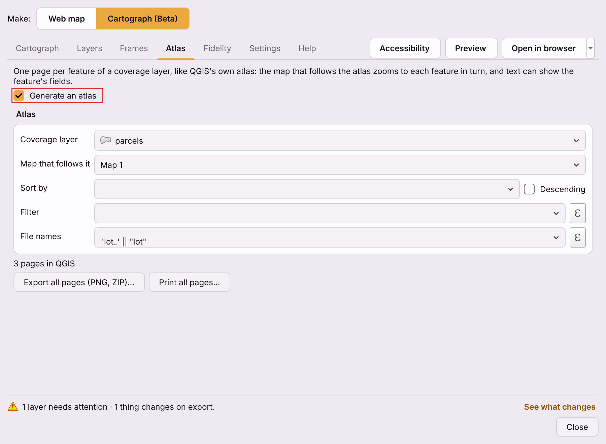

# Atlas cartographs

A QGIS atlas makes one page per feature of a coverage layer: a sheet per
parcel, per site, per corridor segment. A cartograph keeps the atlas in **one
file**. The reader opens it once and turns the pages in the browser, and the
map, the scale bar and every page-dependent label update as they go.

## Setting it up

On the cartograph's **Atlas** tab:

1. Tick **Generate an atlas**.
2. Choose the **Coverage layer** - one page per feature of it.
3. Choose the **Map that follows it**. A map that did not follow the atlas
   before gets QGIS's defaults: it fits each feature, with a 10% margin.
4. Optionally, **Sort by** a field (tick **Descending** to reverse it), a
   **Filter** expression, and a **File names** expression for exported pages.
5. In **Map frames**, on the **Layout** tab, make sure the map that follows the atlas is
   **Live**, and that it **draws the coverage layer**. To keep the layer from
   showing, tick **Hide coverage layer** in the layout's atlas settings rather
   than removing it from the map.

These are the layout's own atlas settings - the same ones as the layout
designer's Atlas panel, which works just as well - so every change is on the
layout's undo stack. While the atlas is on, the tab reads **Atlas (on)**. It
shows how many pages QGIS's atlas has, and, when
the cartograph will not page, a warning line saying why and what to change.

The cartograph saves itself as usual. One file holds every page.

## Why the map has to be live

A static frame is a picture, rendered once. It would show the same place on
every page. The cartograph turns pages by moving a live map to each feature,
and it finds the features in that map's own data - so the coverage layer has
to be in it.

When either is missing, nothing half-works: no atlas is written, and the
Checks tab marks it **Blocked** with the fix - *Set the atlas map to Live in
Map frames*, or *Add the coverage layer
... to map ...'s layers*.

## Turning the pages

In the browser, a reader can:

- press **←** and **→**, **Page Up** and **Page Down**, **Home** and **End**;
- use the pager at the foot of the sheet - `‹ 3 / 12 · Lot 12 ›`.

The pager is for the screen only: it is never printed and never appears in an
exported image.

On every page the map moves to that feature the way QGIS's atlas moves it,
the scale bar is worked out again, and labels using the feature's fields,
`@atlas_featurenumber` or `@atlas_totalfeatures` show that page's values.

## What changes from QGIS

| In QGIS | In the cartograph |
|---|---|
| Map scaling **Margin around feature** | Kept |
| Map scaling **Fixed scale** | Kept: every page at the map's scale, centred on its feature |
| Map scaling **Predefined scale** | Kept: each page at the scale QGIS picks for that feature |
| A **point** coverage layer | Kept: QGIS centres each point at the map's scale, in any scaling mode |
| **Hide coverage layer** | Kept on live frames |
| **Only show the current atlas feature** | Not kept - every feature of the layer is drawn. Marked **Changed** |
| **Filter with** | Kept when the expression has a cartograph equivalent; otherwise left out, so every feature gets a page. Named on the Checks tab |
| **Sort by** | Kept when it sorts by a field. An expression cannot be kept, and pages follow the layer's own order |
| **Output filename expression** | Kept when it can be translated; otherwise pages are named `page-1`, `page-2`, ... |
| **Page name** | Kept when it can be translated; otherwise the pager shows page numbers |
| A label expression that depends on the atlas feature in another way | Reads the same on every page. Named on the Checks tab |

The cartograph can have **fewer pages** than QGIS's atlas. It skips features
the map does not draw - a category switched off in the layer's style, for
example - so it never prints a sheet for a feature nobody can see.

## Exporting and printing every page

Two buttons at the foot of the Atlas tab work on the saved cartograph. They
stay greyed out until it has atlas pages.

- **Export all pages (PNG, ZIP)...** opens the cartograph, which renders every
  page at 300 dpi, one after another through the same live map, and downloads
  them as **one ZIP** (`<name>-atlas.zip`), each page named by the **File
  names** expression. One ZIP rather than one download per page, because
  browsers block a run of separate downloads.
- **Print all pages...** opens the cartograph with every page rendered and
  laid out for one print job. Choose **Save as PDF** for one multi-page PDF; in
  a Chromium-based browser every page is at its true size. Each page is an
  image rendered at 200 dpi, so text in that PDF is not selectable.

**Export PNG...** and **Export PDF...** in the Share menu work on the page the
cartograph opens on, page 1. For a single page, a cartograph opened with
`?export=png&page=3` added to its address downloads page 3.

See also [printing a cartograph](printing-a-cartograph.md#printing-an-atlas).

## Limits

- A layer whose features live on a server (a tiled or streamed layer) cannot
  drive an atlas: the cartograph needs the features inside the file.
- Very large atlases are slow to export as images, because every page is
  rendered in turn by one map. They are not slow to open.
