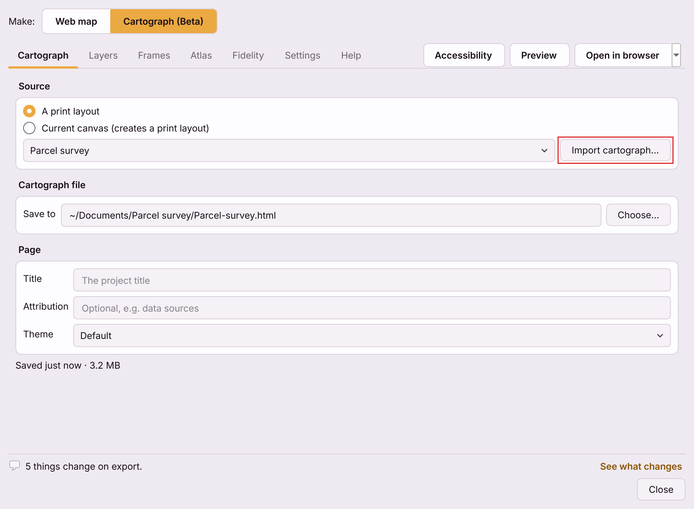
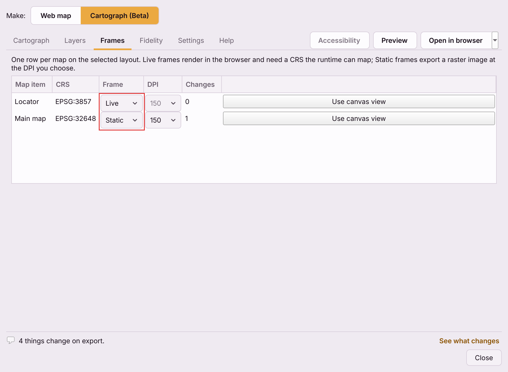
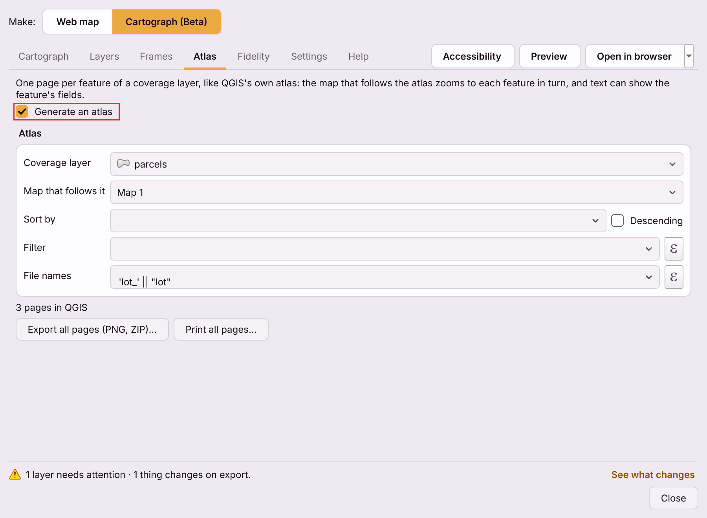
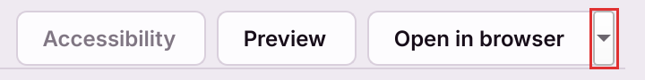

# The Cartograph dialog, tab by tab

Choose **Cartograph** from the title menu at the top of the plugin's dialog
(**Web map ▾**) and the dialog becomes one screen: the print layout's
page on the left and a panel of settings on the right. The header holds
**colour vision**, **Save PDF…** and **Share**, and there is no Export
button. The web map's tabs are described in
[the dialog, tab by tab](the-dialog.md). The **Settings** and **Help** icons
at the right of the header are shared and work the same way.

Other ways in:

- **Web → QGIS2WebMap by NIKA → Create cartograph...**, or **Ctrl+Alt+C**
  (**Cmd+Alt+C** on macOS), opens the dialog straight on Cartograph (Beta).
- In the layout designer, **Layout → Export as cartograph (HTML)...** does the
  same and selects the layout you have open.
- On the web map, **Share → Make a cartograph...** builds a print layout from
  the map canvas and switches over - see [one-click layouts](one-click-layout.md).

## The document model, in one paragraph

A cartograph is **a file that is always saved**, not something an Export
button produces. Selecting a layout saves it at once, and every change after
that - in the panel, in the print layout itself, or to the style or data of a
layer it draws - rewrites the file about 600 ms later, through a temporary
file that is swapped in, so it is never half written. Preview, Share and
the NIKA hand-off all work on that file. The dialog's title names it. Closing
the dialog leaves it where it is, and reopening the plugin on the same project
picks it up again.

Settings are stored with the project, per layout: each layout remembers its
own file, frames, page fields and print settings.

---

## The page

The left side shows the selected layout, captioned **Layout preview — QGIS ·** and its
page size - *Layout preview — QGIS · A4 landscape*, for example. It is QGIS's own
drawing of the print layout, live: a change in the layout designer, a
restyled layer or a new title shows at once.

It is not the HTML. The cartograph can differ in places - a north arrow the
browser draws its own way, the page's theme - and the **Checks** tab lists
every difference. Beside the caption, a link such as **2 changes in the HTML**
opens Checks. To see the real cartograph, press **Preview in browser**. **Open layout editor**,
beside the caption, opens the layout in QGIS's own layout designer. The Page
settings (title, attribution, theme) change the HTML, so they show in
**Preview in browser**, not in this preview.

Under the page, the preview bar: **Fit page**, **Add item**, then **−**, the
zoom level and **+**. 100% is the page at its real size on your screen. The
mouse wheel zooms; drag from an empty part of the page or the workspace
around it (not from an item), or hold **Space** and drag, or drag with the
middle mouse button, to pan. There are no Select and Pan buttons: the page is always in
selecting mode.

**Add item** offers **Text**, **Legend**, **Scale bar**, **North arrow**,
**Live count** and **Detail map**.
Choose one, then click the page to place it at its default size, or drag to
draw its box. The new item is selected and the panel opens its **Edit** tab.

Click an item on the page to select it, drag it to move it, or drag one of its
corner or edge handles to resize it, with the same snapping and
**Shift**/**Alt** keys as the layout designer. A press that moves less than
3 px counts as a click, not a drag. Map frames move and resize like any other
item, and a locked item stays where it is. Double-click an item to open its
**Edit** tab. Every move or resize is one undo step on the layout, so
**Ctrl+Z** and **Ctrl+Shift+Z** work on the page, the cartograph saves itself
after each edit, and the page stops fitting to the window once you have
clicked on it (**Fit page** fits it again). The layout is the same one the
layout designer shows, so an edit in either appears in both.

With no print layout in the project, the page says so and offers
**New from template...** and **Import cartograph...** instead.

---

## Print layout

The top of the panel. The list holds the project's existing print layouts
and follows the Layout Manager as you add, rename or remove them; it never
holds an action. Beside it:

- **Rename...** - renames the layout shown. The cartograph keeps following it.
- **New from template...** - opens the
  [template picker](one-click-layout.md#choose-a-template), which remembers
  the design you chose last time, then builds a layout named
  `<Design> · <project title>` from the map canvas, adds it to the project and
  selects it. A layout made from a template says **Based on** and the
  template's name under the button. Greyed out when there is no map canvas.
- The arrow on the button's right opens a menu with **Import cartograph...** -
  it turns a cartograph HTML file back into a new QGIS print layout, and
  selects it. Whatever QGIS cannot hold is listed when the import finishes.
  See [one-click layouts](one-click-layout.md#importing-a-cartograph-back-into-qgis).

The layout shown is kept as it is; to change its text, move, resize or edit
the items, use the layout preview and the **Edit** tab.

Below the list are four tabs - **Layout**, **Atlas**, **Checks** and **Edit** - and,
at the foot of the panel, [where the file saves](#where-it-saves).

---

## Layout

Three sections that open and close. A closed section shows a few words about
what is in it, such as *Default theme* or *1 interactive map, 1 image*.

### Browser appearance

These settings change the web page only - the layout preview beside the panel
never shows them; use **Preview in browser**.

- **Title** - replaces the project title wherever the layout shows it
  (`[% @project_title %]`). Blank keeps the project title.
- **Attribution** - a credit for the page, such as your data sources. It is
  stored on the page, and shown by any text on it that uses the
  `{{attribution}}` token - text added by hand or by an AI agent, for example.
  A label in the QGIS layout does not use the token, so to print a credit from
  QGIS, write it into a layout label.
- **Theme** - the page's look: **Default**, **Dark**, **Sepia**,
  **Blueprint** or **Minimal**. It colours the page and the furniture - legend,
  scale bar, north arrow, grid - not your map data.

### Map frames

One card per map item on the layout:

- its name - the map's ID in the layout designer - and, at the right, how many
  items on it the cartograph changes (**No changes**, or *2 changes*; Checks
  has the detail);
- its CRS, or *Unknown CRS*;
- **Interactive** or **Image**, in the card's choice box: an Interactive map is
  drawn in the browser, in Web Mercator or in the map's own projected CRS
  ([which one](live-or-static-frames.md#which-crs-an-interactive-frame-draws-in));
  an Image is a picture of the map as QGIS draws it, in its own CRS;
- the image resolution, for an Image frame only: **150**, **200** (the
  default) or **300 dpi**. An Image frame is always drawn at least at the
  saved export resolution, so the choice can only raise it;
- a **⋯** menu: **Use canvas extent** sets the map's extent to what the QGIS
  canvas shows (an edit to your layout, so the layout designer's **Undo** takes
  it back); **Go to location…** centres the map on coordinates or on a feature you
  search for ([below](#go-to-location)); and, when the map
  draws a continuous raster such as elevation, **Smooth when enlarged**
  blends its pixels where the map draws them larger than they are. It changes
  only this map, never the layer's style, and applies to an Image map and to
  the PDF QGIS makes.

### Go to location

**Go to location…** in a card's **⋯** menu changes the area shown *inside* that
map frame; the frame itself, its size and its rotation on the sheet stay as
they are, and so do the QGIS canvas and your data. Nothing happens until you
press **Go**, and **Cancel** or Esc leaves everything untouched. **Go** is one
undo step on the layout's own stack, keeps the map's scale and rotation, and
the Live counts, scale bars and saved cartograph follow it.

- **Coordinates** takes a latitude and a longitude in decimal degrees
  (WGS 84 to start with). **Change…** opens QGIS's own coordinate-system
  chooser; with a projected system the fields become Easting (X) and
  Northing (Y) in the system's units. Changing system converts a complete,
  valid pair to the same place and clears anything else. Values are never
  swapped, clamped or wrapped, and degrees/minutes/seconds, N/S/E/W and a pair
  pasted into one field are not accepted.
- **Feature** searches one layer the map draws, beyond the current view, by its
  display name, its QGIS feature ID or one of its text or whole-number
  fields. Matching is case-insensitive and literal; exact matches come first,
  then names that start with the text, then the rest, and at most 50 are
  shown. Enter in the search box searches; select a result and press **Go**
  (or double-click it, or press Enter on it). **Fit whole feature** is offered
  for lines and polygons and fits them with a 10% margin; otherwise the map
  is centred on the feature (a point on a polygon's surface, the middle of a
  line) at the current scale.
- A map the layout's atlas drives cannot be moved by hand; turn off the map
  series first.

A map starts **Interactive** when the browser can draw it where QGIS does - in
EPSG:3857 or EPSG:4326, or an unrotated projected map of vector layers and
image tiles - and **Image** otherwise. (The Main map in the picture was
switched to Image by hand.) A map the layout's atlas turns also starts
**Interactive**, whatever its CRS.
[Interactive or image frames](live-or-static-frames.md) is the whole story; the
short version is that Interactive costs some styling and file size, and Image
costs interactivity.

The cards follow the layout: add or delete a map in the layout designer and
the list rebuilds.

### Layers

The same list as the web map's Layers tab (search box included), with the same **Include**,
**Popups** and **Labels** columns and **Set every field to**. For a
cartograph it sets how the layers in **Interactive** frames behave:

- **Popups** and the per-field popup settings apply. A layer with Popups
  unticked, or a field set to *Do not show this field*, has those values left
  out of the file - not merely hidden.
- **Labels** applies: unticked, the layer's labels are not drawn in
  Interactive frames.
- **Include** chooses the layers of the map frame named at the top of the
  section (**Layers for:**, a choice of frame when the layout has several).
  Unticking a layer takes it off that map in the layout itself, so it
  disappears from the preview, the HTML, the image and the PDF, and from the
  legends linked to that map. **Undo** in the layout (Ctrl+Z) puts it all back,
  in its old place. A map that followed the QGIS Layers panel or a map theme
  gets its own list of layers the first time you change a tick, drawn with the
  styles it had; the note under the selector says which it is. If the layout's
  atlas takes its pages from a layer the map no longer draws, a warning says so
  and the atlas buttons stay off until it is ticked again. The web map keeps
  its own Include choices, which switching output never touches.

Image frames are pictures drawn by QGIS, so none of this changes them.
Changing anything here saves the cartograph again.

---

## Atlas

**Create a map series**: one page per feature of a layer, in one file. The tab
edits the layout's own atlas - the same settings as QGIS's Atlas panel - so
every change goes on the layout's undo stack, and **Undo** in the layout
designer takes it back. The tab reads **Atlas (on)** while the series is on.
[Atlas cartographs](cartograph-atlas.md) explains the rules.

| Control | What it is |
|---|---|
| **Create a map series** | Turns the series on or off. While it is off only the explanation shows; settings are kept |
| **Make one page for each feature in** | The layer whose areas or locations become pages. Nothing is chosen for you; the tab says how many ("3 areas", "12 locations") |
| *Updating map: Main map* / **Map to update on each page** | With one map the tab names it. With several, choose which one; the others keep their current view. With none, **Browse templates...** |
| **Previous** / **Next** | Step through the pages in the page beside the panel. Moving is not an edit, and leaving the tab puts the layout back as you authored it |
| *3 pages ready* | The number of pages. A layout with several sheets per feature says so |
| **Export series...** | Asks for PDF (QGIS's own, always available), Images (ZIP) or Web page (HTML) |
| **Print series...** | Asks how to print: **Print with QGIS** (every page, in order, through the system print dialog; no Interactive map needed; with no printer available the series is saved as a PDF to print from, and the status says nothing was printed) or **Print from the web page** (needs Interactive maps). **Switch to Interactive** sits beside that choice (and in **Export series...** for the ZIP and web page): one undoable step |
| **Page framing** | Fit area with margin, Fixed scale or Predefined scales |
| **Advanced settings** | **Include pages** (a filter), **Page order**, **Page names**, **Export filenames**. Opens by itself when a setting is wrong |

Each output is checked on its own: the saved cartograph's page count does not
enable or disable anything.

---

## Edit

The tab for the item selected on the page. Its heading says what is selected
or, with nothing selected, how to select something. Double-click an item, or
place one with **Add item**, and the panel switches here. Every edit is one
undo step on the layout.

- **Any item with text** - **A−** and **A+** change the lettering size one
  point at a time. Resizing the item's box is separate: use its handles on the
  page.
- **Text** - the words, **bold**, alignment and colour.
- **Map** - **Edit view** (**Edit inset view** on a locator inset) pans and
  zooms what the map shows inside its frame by dragging on the page. **Context
  layers...** chooses what a locator inset draws, **Fit context** fits the
  inset to them, and **Remove inset** deletes it. **Use canvas extent** takes
  the QGIS canvas's extent, a rotation box turns the map, and **Interactive**
  or **Image** (with an Image's resolution) is the same choice as on the map's
  card in Map frames.
- **Legend** - the legend editor: which layers and classes it lists, their
  labels, their order, **restore** for removed entries, columns, text size and
  row spacing, and the map it is about.
- **Scale bar** and **North arrow** - the map they are linked to.
- **Live count** - a number that counts what a map frame currently shows, with
  a caption under it. It follows one map (**Following: Main map**; with several
  maps, choose which). **Count from** is the layer; **Count** is **All features**
  or **Matching a value** (a **Field** and a **Value**; "no value" is offered
  apart from an empty text). The count is the layer's features in the ground
  the frame shows (including its rotation), as the frame draws them: a layer the
  frame does not draw, a switched-off category or rule, a layer filter and a
  scale limit all apply, and a line or polygon counts once if any part of it is
  shown. It updates by itself when the map, the layers or their styles
  change. The number reads **—** while the counter is not set up or its layer,
  field or map is gone (the Edit tab says which), and **n/a** if it could not
  be calculated; it is never a made-up 0. The lettering and position are
  the ordinary text controls; the number itself cannot be typed over.
  Saving, printing and exporting use the number of the view that leaves. In a
  map series the PDF and **Print with QGIS** work out each page's own number
  after the page's map is set up. The exported web page, the image ZIP and web
  printing hold the number as fixed text, so it is the same on every page (and
  does not change when a reader pans or zooms an Interactive map); **Export
  series...** and **Print series...** say so beside those choices.
- **Delete** - removes the selected item (also the Delete key).

---

## Checks

The cartograph's report: every layout item that changed or was left out on
the way to the HTML, with the verdicts **Kept**, **Changed**, **Rasterised**,
**Not exported** and **Blocked**. The tab's title carries the count -
**Checks (2)** - and it refreshes after each save. Before the first save it
reads *Not checked yet*, and **Check now** saves the cartograph to check it.

Each problem is one readable line; click it to read the whole sentence and,
where the fix is in the dialog, a button that goes there - **Show in Layers**,
for example. **Filter** and the search box work as on the web map's
[Fidelity tab](the-dialog.md#fidelity).

Layout items are listed under **Whole map**, and the layers the frames draw
get their own groups - an image frame's layers marked **Rasterised**, since
they are part of its picture. The verdicts are explained in
[what a cartograph keeps](cartograph-supported-features.md).

---

## Where it saves

The foot of the panel names the file: its name in bold, its folder under it,
and two links - **Change...** to save it somewhere else, and **Show in
folder**. Under them, the save status:

- *Saved just now · 3.3 MB* - the file on disk matches what you see;
- *Changes pending* - you edited something and the file has not been
  rewritten yet;
- *Saving the cartograph...* - the file is being rewritten. These two are about
  the cartograph's HTML file only; the dialog never saves your QGIS project;
- *Not saved yet* - the first save is still running;
- a sentence starting *Could not...* - the save failed, and why. The previous
  file is left untouched.

By default a cartograph saves in **Documents/QGIS2WebMap/Cartographs**, named
after the project and the layout - `parcels-Survey.html` for the layout
*Survey* in `parcels.qgz`. Anything other than letters, digits, dots and
hyphens becomes a hyphen. A project that has never been saved has no name
yet, so the layout's name alone is used, and the cartograph still saves at
once. If a file of that name is already there, the new one gets a number:
`parcels-Survey (2).html`. To use another folder for every new map, see
**Settings → Saving** in [the dialog, tab by tab](the-dialog.md#settings).

A cartograph only saves over a file that is its own earlier output, or one you
picked in **Change...** and agreed to replace. If the project names any other
file - a text file, somebody else's page, a link, a folder, or a folder that
does not exist - that file is left alone, the cartograph saves to a free name
beside it (or in the default folder), and the message under the file name says
where.

A cartograph is always **one standalone HTML file**. There is no Share ZIP or
Folder type as there is for the web map: the page, the pictures of its Image frames and the
data of its interactive maps are all inside it.

---

## The header

At the top right, reachable whatever the panel shows:

- **Colour vision** (the contrast icon) - opens the
  [Colour vision](colour-vision.md) dialog: simulate colour-vision deficiencies
  on the canvas and in the browser, and check which legend classes become
  indistinguishable. Stays pressed while a simulation is on, and its tooltip
  names it.
- **Save PDF…** (**Ctrl+P**) - saves every page of the selected layout as a PDF,
  written by QGIS itself from a copy of the layout, so edits you made a moment ago
  are in it and nothing else changes. It asks where to save (suggesting the layout's
  name), needs no saved HTML file and opens no browser. Interactive frames are drawn
  as static maps of their current view. Greyed out, with "Choose or create a layout
  first", until a layout is selected. While it runs the status line says "Saving
  PDF…"; afterwards it offers **Open PDF** and **Show in folder**.
- **Share** - opens the [Share menu](#the-share-menu).

Then the **Settings** and **Help** icons, as on the web map.

The browser opens the file through a small server on your own machine
(`127.0.0.1`) rather than as `file://`, because some browsers refuse to run a
interactive map from a file path. Nothing leaves your computer.

---

## The Share menu

The header's **Share** button. An **Export** section, an **HTML cartograph**
section, then the greyed NIKA rows.

| Row | What it does | Available |
|---|---|---|
| **Save atlas as PDF...** | One run of pages per atlas feature, in a single PDF, written by QGIS; never just the feature on screen | Only when an atlas is set up |
| **Export PNG...** | Opens the cartograph, which renders an image of the page at the saved resolution and downloads it - page 1 of an atlas; the Atlas tab exports every page | Once the file exists |
| **Export QGIS layout template (.qpt)...** | Saves the source layout as a `.qpt` template, to load into another project | Once a layout is selected |
| **PDF settings...** | Page size, resolution, bleed, crop marks, safe zone and colour profile for Save PDF… | Once a layout is selected |
| **Preview in browser** (**Ctrl+O**) | Opens the HTML cartograph, once the save holding your latest edits has landed, to check interactive maps and browser behaviour | Once the file exists |
| **Copy HTML file path** | Puts the cartograph's path on the clipboard | Once the file exists |
| **Show HTML in folder** | Opens the folder the HTML cartograph is in | Once the file exists |
| **Prepare enhancement prompt...**, **Prepare critique prompt...** (NIKA hand-off) | Shown greyed out: the hand-off is not available for cartographs yet | Not yet |

**Ctrl+O** (Preview in browser) and **Ctrl+P** (Save PDF…) work from anywhere in the dialog, without opening
the menu.

Export PNG is **derived** from the cartograph rather than being
the export: the browser makes it from the saved file. It waits until every
raster in the page has drawn - a note at the foot of the page says so - and if
one cannot draw, it stops with a message rather than save a page
without it. Rasters draw with no internet connection. Save PDF… is different:
QGIS writes it from the layout, not from the HTML. Both are covered in
[printing a cartograph](printing-a-cartograph.md).

There is deliberately no Share ZIP, no Folder, and no report row. A cartograph
travels as its one file, and the Checks tab is always one click away.

---

## Processing

For models and batch runs, the Processing Toolbox has **QGIS2WebMap by NIKA →
Cartograph → Export print layout to cartograph (Beta)**. It runs the same
export as the dialog, once, with these parameters:

| Parameter | What it is |
|---|---|
| **Print layout** | The layout to export |
| **Frames** | **Automatic** (interactive where it matches QGIS, image otherwise - the dialog's default), **All interactive** or **All image** |
| **Image frame resolution (dpi)** | 72 to 600; 200 by default, as in the dialog |
| **Title** | Replaces the project title; blank keeps it |
| **Export even if some items are blocked** | Off by default, so a **Blocked** item - an atlas on an image map, say - stops the run and names it. Pages after the first are *Not exported*, not Blocked: they are logged and page 1 is written |
| **Cartograph** | Where to write the `.html` |

Every check is written to the log. Print settings, the Browser appearance fields, per-map
choices from Map frames and the Layers section's popup and label choices are
not used: the algorithm takes only its own parameters.

On a computer that has never downloaded the OnlyMap runtime, the algorithm
stops and says so - it cannot show the licence in a batch run. Save one
cartograph or web map from the dialog first.

---

## Next

- [Your first cartograph](cartograph-first-export.md) - the same ground as a
  walkthrough
- [Interactive or image frames](live-or-static-frames.md)
- [Printing a cartograph](printing-a-cartograph.md)
- [What a cartograph keeps](cartograph-supported-features.md)
- [Troubleshooting](troubleshooting.md#cartographs)
