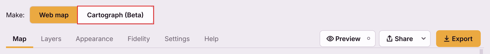
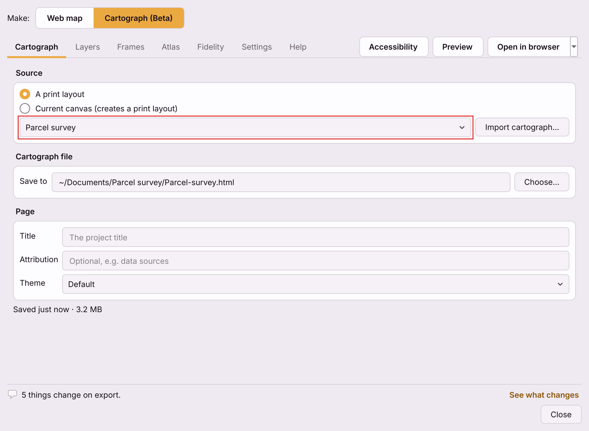
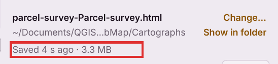
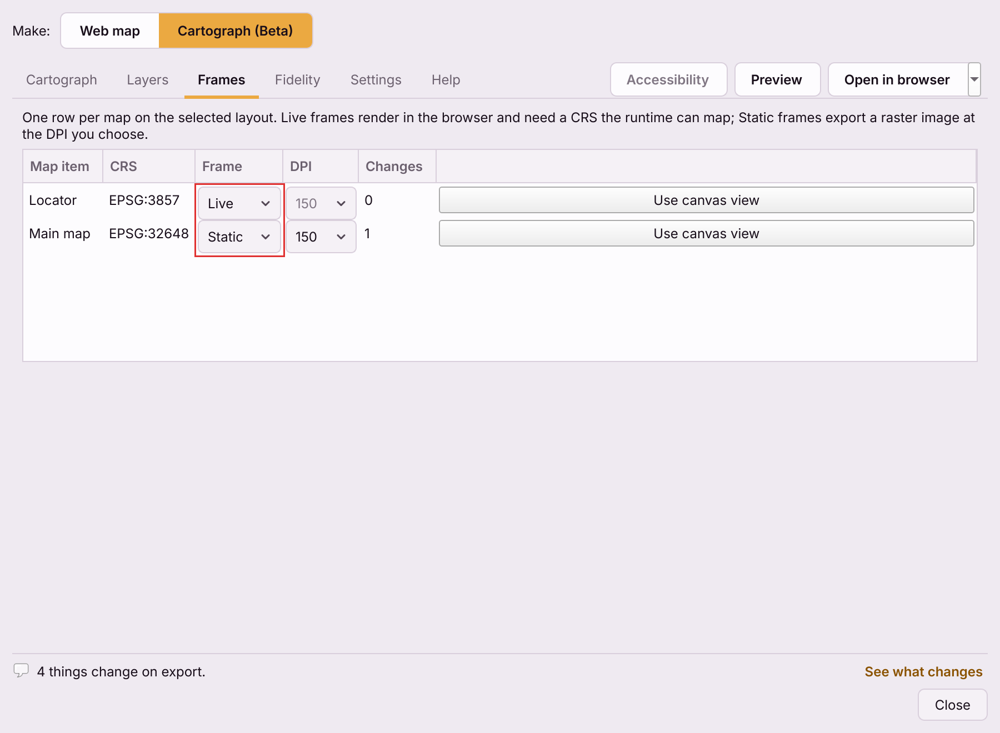
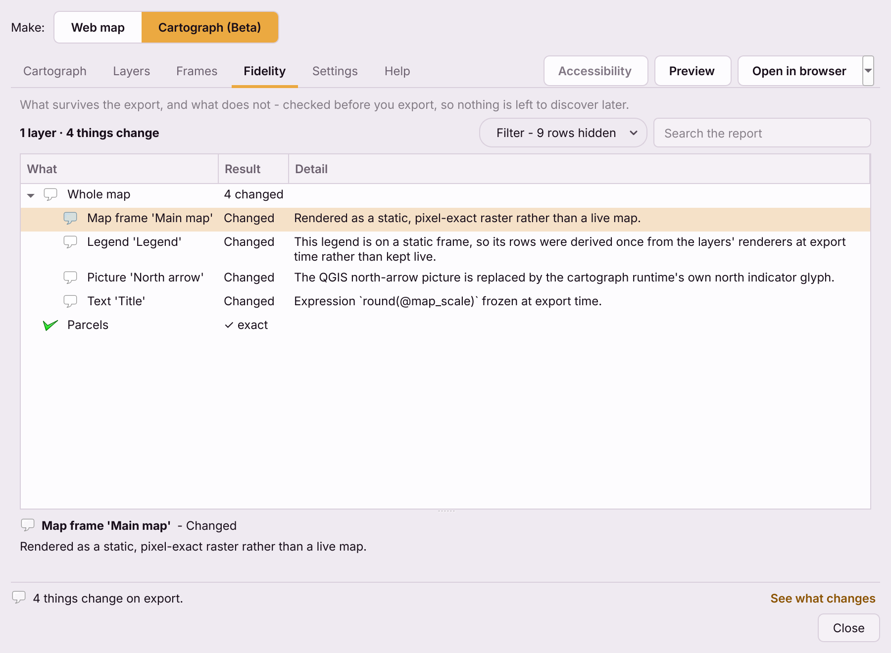

# Your first cartograph

A **cartograph** is a print layout as one HTML file: it opens by
double-click, prints at the layout's page size, and its maps can stay interactive.
This page goes from a QGIS print layout to a file you can send. If you have not
installed the plugin yet, start with [installation](installation.md).

## 1. Make the print layout

Build the layout in QGIS's layout designer the way you always would - one or
more maps, a legend, a scale bar, a north arrow, a title. The plugin reads the
layout as it is, and follows it: change the layout later and the cartograph
updates itself.

Two limits worth knowing before you start:

- **Only page 1 is exported.** A layout with more pages still saves, with page 1
  only, and the Checks tab marks the rest **Not exported**. An
  [atlas](cartograph-atlas.md) is the way to get many pages.
- **Some items have no cartograph equivalent** - HTML frames, attribute
  tables, polylines and polygons drawn on the page, among others. They are left
  out and named. [What a cartograph keeps](cartograph-supported-features.md)
  has the full list.

No layout at all? Skip to step 3 and press **New from template...**.

## 2. Open the Cartograph output

Any of these opens the plugin on Cartograph (Beta):

- **Web → QGIS2WebMap by NIKA → Create cartograph...**
- In the layout designer, **Layout → Export as cartograph (HTML)...** - this
  also selects the layout you have open.
- Press **Ctrl+Alt+C** (**Cmd+Alt+C** on macOS) - the dialog opens on
  Cartograph (Beta).
- Open the plugin as usual (**Ctrl+Alt+W**, **Cmd+Alt+W** on macOS), click
  the title at the top left - **Web map ▾** - and choose
  **Cartograph**.

The dialog remembers which of the two you used last, per project.

## 3. Choose the print layout

The screen splits in two: the page on the left, and a panel on the right. At
the top of the panel, under **Print layout**:

- **Pick a layout from the list.** Every print layout in the project is
  there, and the list follows the Layout Manager: add, rename or delete a
  layout and it updates. **Rename...** renames the one shown.
- **Or press New from template...** - pick one of eleven
  [templates](one-click-layout.md#choose-a-template), and a new layout called
  `<Design> · <project title>` is built from what the map canvas shows, added to
  the project and selected.

The page on the left is now the layout, captioned with its size -
*Layout preview — QGIS · A4 landscape*. It is QGIS's own drawing of the layout and
follows every change you make. Zoom with the bar under it or the mouse wheel,
and hold Space (or the middle mouse button) and drag to pan.

**New from template ▾ → Import cartograph...** goes the other way: it turns a cartograph
file back into a QGIS print layout.

## 4. Check where it saves

The foot of the panel names the cartograph file: the file name in bold, its
folder under it, and **Change...** and **Show in folder** beside them. By
default it is in **Documents/QGIS2WebMap/Cartographs**, named after the
project and the layout - `parcel-survey-Parcel-survey.html` for a layout
called *Parcel survey* in `parcel-survey.qgz`. If that name is taken, the new
file gets a number, such as `(2)`.

The first save happens as soon as the layout is selected - even in a project
that has never been saved. Press **Change...** to put the file somewhere else.

There is **no Export button**, on purpose. The cartograph is a file that is
always up to date: about half a second after any change - in the panel, in
the layout itself, or to a layer's style or data in QGIS - the plugin
rewrites it. The line under the file name says how it went:

| It says | It means |
|---|---|
| *Not saved yet* | The first save is still running |
| *Saved just now · 3.3 MB* | The file on disk matches what you see |
| A sentence starting *Could not...* | The save failed, and why. The previous file is left untouched |

A save writes to a temporary file and swaps it in, so closing QGIS mid-save
never leaves half a file behind. The first save on a computer may ask to
download the OnlyMap runtime, the same one-off download the web map uses.

## 5. Choose interactive or image frames

On the **Layout** tab, open **Map frames**. Each map on the layout has a
card:

- its name, and how many items on it change in the cartograph;
- its CRS;
- **In the HTML** - **Interactive** (pan and zoom) or **Image** (a picture of the map);
- for an image frame, the image resolution: 150, 200 (the default) or
  300 dpi;
- **Match QGIS canvas**, which sets this map's extent to what the QGIS canvas
  shows.

A map starts **Interactive**, an interactive map in the page, when the browser can
draw it where QGIS does: in **EPSG:3857** or **EPSG:4326**, or in a projected
CRS such as a UTM zone when the map is not rotated and holds only vector
layers and image tiles. Anything else - a rotated map, a map with a raster
file - starts **Image**: an image of the map exactly as QGIS draws it, in its
own CRS. The survey in these pictures starts Interactive; its Main map was switched
to Image to keep the parcel styling pixel-exact for print. [Interactive or image frames](live-or-static-frames.md) explains
the trade, including why a page of only image frames is small and needs no
graphics card.

## 6. Preview it

**Preview**, at the top right of the dialog, opens the saved cartograph
in your default browser. The page on the left is QGIS's drawing of the layout;
this is the real HTML. **Share** beside it opens the
[Share menu](cartograph-dialog.md#the-share-menu), with PDF and PNG export,
the layout template and the NIKA hand-off.

Nothing opens until there is a saved file. If you press Preview before
the first save, the bar at the foot of the dialog says so.

## 7. Read the checks

The **Checks** tab lists every layout item that did not come across exactly,
with one of the same verdicts the web map uses - **Kept**, **Changed**,
**Rasterised**, **Not exported**, **Blocked**. It fills after each save, and
its title carries the count - **Checks (5)**, say. The link beside the page's
caption, such as **5 changes in the HTML**, opens it too.

Typical rows for a first cartograph:

- *Rendered as a pixel-exact image rather than an interactive map* - a map you
  left as an Image.
- *Expression `round(@map_scale)` frozen at export time* - a label expression
  the page cannot work out by itself, written in as text.
- *The QGIS north-arrow picture is replaced by the cartograph runtime's own
  north indicator glyph.*
- *Drawn into this image frame's picture by QGIS* - **Rasterised**, for each
  layer of an image frame: it looks exactly as in QGIS, but a reader cannot
  click it.

Then send the file. The recipient needs a web browser and nothing else. See
[sharing a cartograph](share-qgis-print-layout-without-qgis.md) and
[printing a cartograph](printing-a-cartograph.md).
