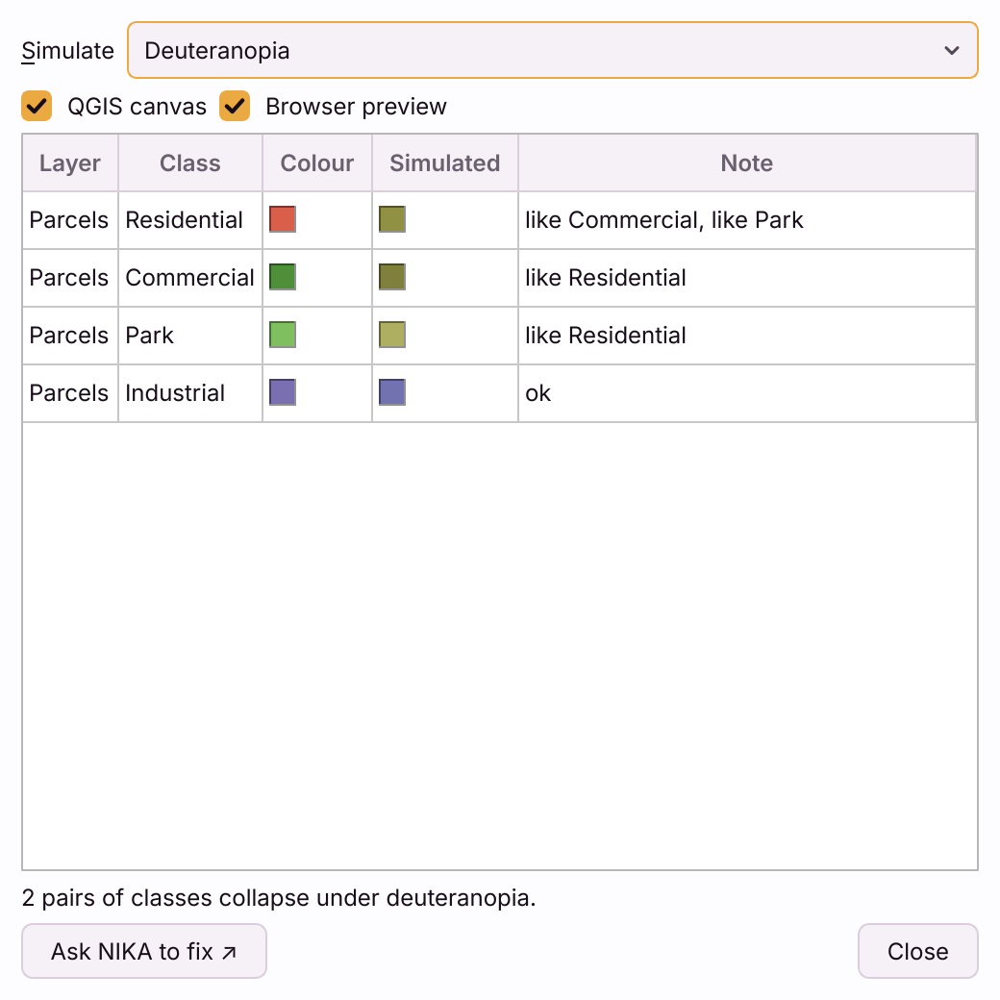

# Colour vision

About one man in twelve and one woman in two hundred see colour differently.
A legend whose classes are red and green can be a legend of one colour to
them. The **Colour vision** dialog shows you the map as they see it, and
checks the legend for you: which classes collapse into each other, and for
whom.

Open it with the **colour vision** button (the contrast icon) at the top
right of the dialog, on Cartograph (Beta). It floats beside the dialog and
stays open while you work.

## Simulate

Choose a condition under **Simulate**:

- **Normal vision**
- **Protanopia** - no red-sensitive cones
- **Deuteranopia** - no green-sensitive cones, the most common
- **Tritanopia** - no blue-sensitive cones, rare
- **Grayscale (achromatopsia)** - no colour at all; also how the page looks
  photocopied

It applies to two places, each with its own tick box:

- **QGIS canvas** - filters the map canvas, the same as QGIS's own
  **View → Preview Mode**.
- **Browser preview** - reopens the cartograph in your browser with the same
  simulation applied to the whole page.

While a simulation is on, the colour vision button stays pressed and its
tooltip names the condition. Closing the dialog leaves the canvas as you set
it - choose **Normal vision** to switch it off. A preview mode you had set in
QGIS yourself before opening the dialog is left alone.

## Check

The table lists every legend class, layer by layer:

| Column | What it is |
|---|---|
| **Layer**, **Class** | The legend entry |
| **Colour** | Its colour |
| **Simulated** | The same colour as the chosen condition sees it |
| **Note** | **ok**, or **like** the classes it can no longer be told apart from |

Under the table, one line sums it up: *2 pairs of classes collapse under
deuteranopia*, or *All classes stay distinguishable under every condition*.
With **Normal vision** chosen, the table shows every collapse under any
condition, each marked with the condition it happens under.

Two classes count as collapsing when their simulated colours are closer than
a CIEDE2000 difference of 10 - roughly, too close to tell apart at swatch size
on a legend. Only classes of the same layer are compared, since a reader tells
two layers apart by where they sit in the legend. Classes that already look
alike with normal vision are not reported here: that is a different problem
with the palette.

It is the same check the cartograph's own validator runs, with the same
numbers, so the dialog and the file never disagree.

**Which classes are listed.** Every class of every layer drawn in an **Interactive**
frame, and the written-out rows of each legend on an **Image** frame - what
the saved cartograph's legends actually show. Each layer appears once, however
many frames draw it. The table describes the last save, and refreshes after every
save while the dialog is open; before the first save it is empty.

## Ask NIKA to fix

**Ask NIKA to fix ↗** is shown greyed out for now: the
[hand-off to NIKA](enhance-with-ai.md#hand-off-to-nika) is not available for
cartographs yet. The findings above name each pair, the conditions it
collapses under and how close it comes, which is what the advice below works
from.

## Fixing a palette yourself

- Vary **lightness**, not only hue. Two colours that differ in lightness stay
  apart for almost everyone, and in greyscale.
- Avoid pairing red with green, and blue with purple, for neighbouring
  classes.
- For a graduated layer, a single-hue ramp from light to dark survives every
  condition.
- Change the colours in QGIS; the cartograph saves itself, and the table
  updates.
