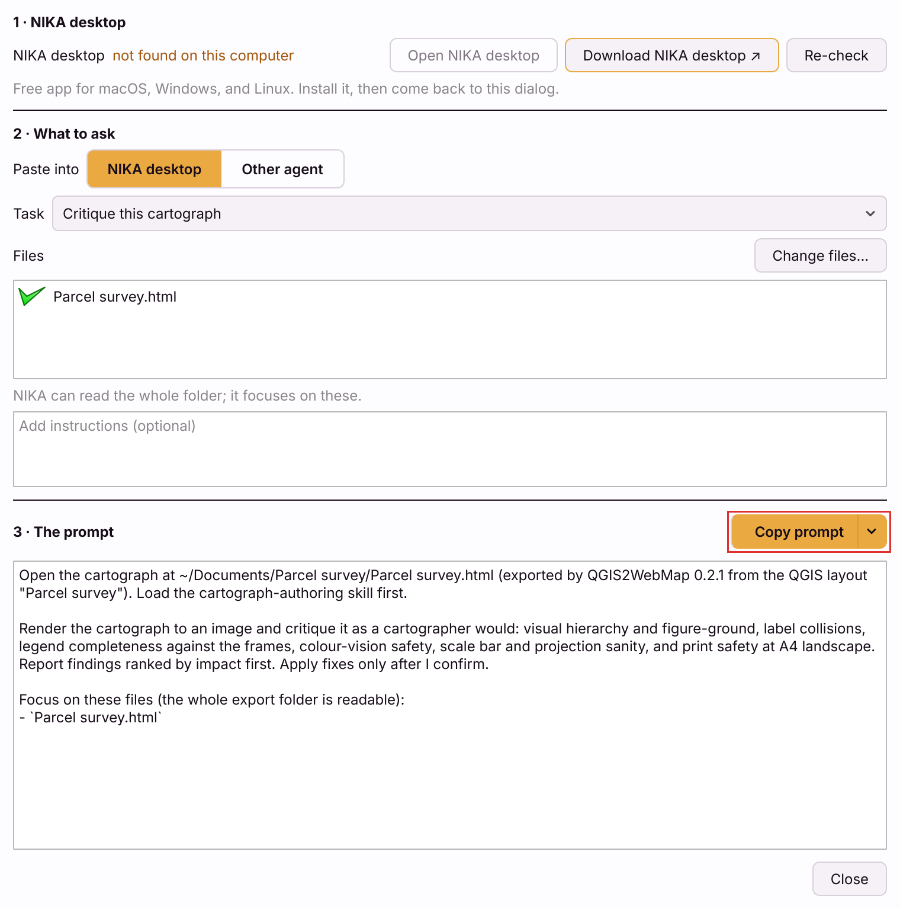

# Enhance a map with AI

An exported map is a readable HTML document, not a compiled bundle. The map is
described by plain markup you can edit — which means an AI assistant can edit it
for you, and you do not have to write any code yourself.

That is a consequence of what your map is built on. It runs on
**[OnlyMapJS](https://github.com/NikaGeospatial/onlymap-js)**, a library anyone
can use and whose whole vocabulary is documented — so a coding assistant can
look up how it works and change your map for you: new colours, a filter, a
chart, your own branding. You describe what you want in plain language; it edits the file.
Any assistant will do, and the rest of this page is about getting a good result
from whichever one you already use.

**You do not need to understand the markup below to do this.** It is here so you
can see there is nothing hidden; skip to
[Start with NIKA Agent](#start-with-nika-agent) if you would rather just ask
for what you want.

## What the file looks like inside

```html
<om-map center="[-160.65, 57.4]" zoom="4" basemap="none">
  <om-layer id="airports" type="GeoJsonLayer"
            label="Airports"
            get-fill-color="$kind == 'civil' ? '#2e8b57' : '#b22222'">
    <script type="application/json">{ ...your data... }</script>
  </om-layer>
  <om-widget type="legend" position="top-end"></om-widget>
</om-map>
```

Layers, colours and controls are attributes. Change one and reload the file.

## Start with NIKA Agent

If you are not already at home in a terminal, this is the one to reach for.
<!--
  Deliberately not a link. The only public page for it documents a different
  product, which is worse than no link at all. Restore one when NIKA Agent has
  a page of its own - see the beta note below, the name is still settling.
-->
**NIKA Agent** is NIKA's own
agent application — built by the same people as this plugin and as OnlyMap, the
library your exported map runs on. It is an ordinary desktop application, not a
command line: point it at a folder, describe what you want in plain language, and
it works through the job itself.

That last part is why it is first on this page. Every other assistant has to be
taught OnlyMap's vocabulary before it can safely touch your map, and the section
below exists entirely to work around that. NIKA Agent already knows it.

Ask in the same words you would use with a colleague:

> Open the map I exported to this folder. Add a filter for the `kind` field, and
> make the civil airports blue. Do not change the data or the attribution.

> **In beta.** NIKA Agent is currently listed as **NIKA Desktop** while the
> naming settles, and it is still being finished — so if something it does to a
> map is not what you asked for, keep the original export and
> [tell us](mailto:support@nikaplanet.com). Using
> [any assistant that can read files](#or-any-assistant-that-can-read-files) is
> the older, more settled route.

## Hand off to NIKA

The plugin can write the request for you, but in this version neither the
web map's nor a [cartograph's](cartograph-dialog.md#the-share-menu) **Share**
menu offers the **Prepare enhancement prompt...** and **Prepare critique
prompt...** rows. Until they return, write the request yourself as above.

The **Hand off to NIKA** dialog that opens has three steps, top to bottom:



1. **NIKA desktop** - whether the app is installed on this computer, and its
   version when it is. Found, **Open NIKA desktop** is enabled. Not found,
   **Download NIKA desktop ↗** opens the download page in your browser; install
   it and press **Re-check**. The plugin finds the app by looking in the usual
   install folders on disk - it asks no server.
2. **What to ask**:
   - **Paste into** - **NIKA desktop**, for a prompt its map skills recognise,
     or **Other agent**, for a prompt any coding assistant can follow, which
     starts by sending it to OnlyMap's own documentation - the
     [OnlyMap skill](https://raw.githubusercontent.com/NikaGeospatial/onlymap-js/main/skills/onlymapjs/SKILL.md).
   - **Task** - **Critique** asks for a cartographer's review, ranked by
     impact, and asks the agent to change nothing until you confirm.
     **Enhance** asks it to improve the map or page without changing its data,
     fixing what the Fidelity or Checks tab marked *Changed*. The menu row you chose
     preselects it.
   - **Files** - the map file, ticked. **Change files...** picks
     others from the same folder; anything from elsewhere is left out, because
     the agent works in that folder.
   - An optional box for your own instructions.
3. **The prompt** - read-only, rebuilt as you change anything above it, so what
   you see is exactly what is copied. **Copy prompt** puts it on the clipboard
   (the button reads *Copied* for a moment). Its arrow also has **Open NIKA
   desktop**, which copies the prompt and opens the app ready to paste, and
   **Save prompt as .md...**.

**Nothing is sent anywhere.** The plugin never talks to NIKA or to any AI
service: the prompt goes onto your clipboard or into a file, and you paste it
where you choose.

The [Colour vision](colour-vision.md) dialog's **Ask NIKA to fix ↗** is a
cartograph tool, so it is greyed out for now too.

## Or any assistant that can read files

Claude Code, Codex and similar tools work too — the exported file is just HTML.
Open it and describe what you want:

> Read this exported map. Add a filter widget for the `kind` field, and change
> the civil airports to blue. Keep the data and the attribution unchanged.

### Give a general assistant the OnlyMap skill first

An assistant that has not seen OnlyMap's attribute vocabulary will guess, and
guesses produce a map that no longer opens. OnlyMap publishes a skill file that
teaches it the real syntax. Point your assistant at it before asking for
changes:

> Read the OnlyMap skill at
> <https://raw.githubusercontent.com/NikaGeospatial/onlymap-js/main/skills/onlymapjs/SKILL.md>.
> Inspect this exported map, preserve its data and attribution, then add
> <what you want>. Validate the result by opening it locally, and keep the map
> portable.

**Claude Code** users can install it once instead of pasting the link each time:
copy [`skills/onlymapjs/`](https://github.com/NikaGeospatial/onlymap-js/tree/main/skills/onlymapjs)
into `~/.claude/skills/`, and it loads whenever you work on an OnlyMap file.

Useful things to ask for:

- new colours, or a different colour scheme
- a filter or search control
- a title, a legend caption, or different wording
- a chart alongside the map
- a story that steps through several views

## Two rules

1. **Do not edit the runtime.** The large `<script>` block at the bottom is
   minified library code. Nothing you want to change lives there.
2. **Keep the attribution.** If your data came with a licence or a required
   credit, it has to stay.

## Cartographs too

A [cartograph](qgis-print-layout-to-html.md) is the same kind of file: a page
described in readable markup - `<om-cartograph>`, `<om-frame>`, `<om-legend>` -
with sizes in millimetres. The same two rules apply, plus one: **keep every
element's `id`**, because the legend, scale bar and north arrow find their map
by it. The ids are readable: each is
named after the item's ID in the QGIS layout designer - `frame_main_map`,
`legend_legend` - so give layout items sensible IDs and the HTML, and any
agent working on it, reads the same names you do.

## Reference

- **[OnlyMapJS on GitHub](https://github.com/NikaGeospatial/onlymap-js)** — the
  source of the library your exported map runs on. The README walks through the
  same `<om-map>` and `<om-layer>` attributes you saw above, with live examples
  of each, and the `skills/` folder holds the skill file this page asks you to
  hand your assistant. Read it if you want to know what is possible before you
  ask for it.
- **[onlymap.nikaplanet.com](https://onlymap.nikaplanet.com/)** — the same
  library, written up as documentation rather than as a code repository. Start
  here if GitHub is unfamiliar territory.
- The full attribute vocabulary is at
  [docs.nikaplanet.com](https://docs.nikaplanet.com).
