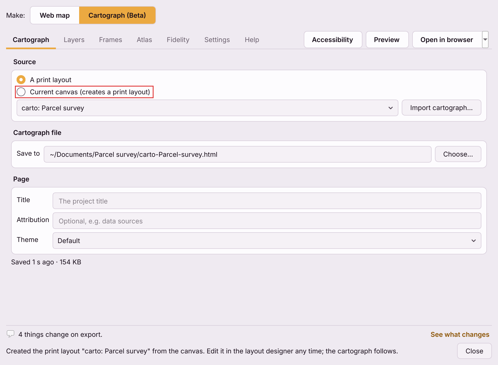
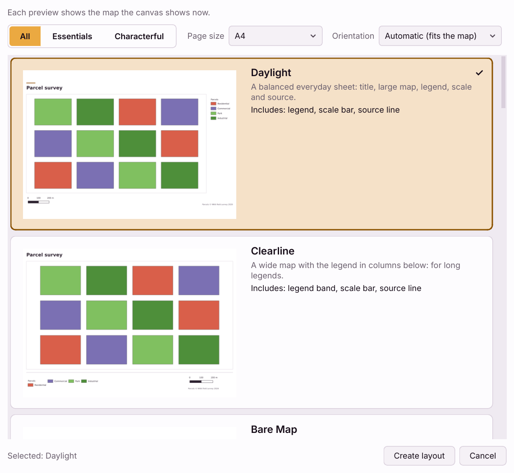

# One-click layouts and the round trip

You do not need a print layout to make a cartograph. One click turns the map
canvas into one - and, unlike tools that go straight to a PDF, it leaves a
real QGIS print layout behind that you can keep editing. A cartograph can also
go the other way, back into QGIS as a layout.

## From the canvas

1. Set the canvas to the view you want on the page: the extent, the layers,
   even a rotation.
2. On Cartograph, press **New from template...** beside the **Print layout**
   list. On the web map, **Share → Make a cartograph...**
   does the same and switches the dialog to Cartograph (Beta).
3. Pick a [template](#choose-a-template), a page size and an orientation, and
   click **Create layout**.

The plugin builds a print layout called **`<project title> — <Design>`**
(for example `Parcel survey — Daylight`; a project with no title says
*untitled*, and a number is added if the name is taken), adds it to the project, and selects it in the Print layout list.

## Choose a template

Eleven starters: six quiet essentials and five specialised compositions, each
made for a different kind of page. The two dark designs, After Hours and Night
Desk, come last, followed by a **Request a template** card that opens a form to
suggest a design you would like to use. Each preview is the real page drawn
with the map the canvas shows now, so what you pick is what you get.

The picker shows **All**, **Essentials** and **Characterful** at the top to
narrow the list, with **Page size** and **Orientation** beside them. Below is
a scrolling list of the designs: a large preview of each, its name, one line
on what it is for, and what that page includes for this project. A second,
quieter line, **Can also show**, lists what the design would add with more
content - notes from the project's abstract; point at it to see where each comes from. Point at a card to see, in its tooltip, what the design is best
for (also listed below). **Create layout** builds the one selected.

The picker only chooses: a design, a page size, an orientation and the map
framing. What goes on the page is edited on the layout once it exists. Select
a title, a note or the legend on the page and change its lettering with **A-**
and **A+**, **B**, alignment and colour in the **Edit** tab; each change is one
undo step. A project that earlier versions gave Title, Legend or Notes sizes
keeps showing them on the pages it makes.

**Essentials**

- **Daylight** - a balanced everyday sheet: title, large map, legend beside
  or below it (whichever leaves the map larger), scale bar and source line.
  The safest first choice; the layout described
  [below](#what-the-daylight-layout-contains). *Best for: everyday maps, reports and emails.*
- **Clearline** - a wide map with the legend in columns in a band under it,
  for wide extents and long legends. *Best for: wide maps with long legends.*
- **Bare Map** - just the map and its data credits, with no frame line, for
  placing in another document. The credits stay because most basemap and
  open-data licences require them. *Best for: pasting into a report, slide or web page.*
- **Caption** - a report figure: the map with a caption under it (the title
  as a bold lead, then the project's abstract), the scale bar and the source. *Best for: reports and papers that caption their figures.*
- **After Hours** - a dark page with an uninterrupted map. Its heading,
  legend and scale have their own space, so a dense key never covers the
  terrain. The legend fits beside or below the map at a readable size. *Best for: dark-room screens and projected displays.*
- **Night Desk** - a calm dark report sheet: the map inset with wide margins and
  a quiet legend, scale bar, source line and date. *Best for: reports read on screen in low light.*

**Characterful**

- **Fieldbook** - a survey sheet with a labelled grid in the map's own units
  and a title block with the scale, CRS, author and date, in a column beside
  the map or a band under it - whichever shows your view larger, so a wide
  view gets a wide frame. *Best for: field surveys and site records.*
- **Broadside** - a poster: a big headline that steps down in size for long
  titles, a dominant map, and the story, legend and scale bar in a rail beside
  it, or in a band below it when that shows your view larger - on a portrait
  page, or for a wide view. *Best for: posters and wall displays.*
- **Near & Far** - the map with a locator inset that outlines where it is,
  beside the map or below it, whichever shows your view larger. *Best for: maps of a small area that need locating.*
- **Signal** - a data-led page: the map with its notes, legend and scale bar.
  Where a project holds key figures (a value such as *214* over what it
  counts), Signal draws them as ordinary text, which you select and edit like
  any other text on the page. With a substantial legend, Signal arranges the
  figures in a row or gives the key a full-height column to keep its entries
  readable. *Best for: data summaries and briefings with key statistics.*
- **Wayfinder** - a long map for routes, rivers and coasts, with a distance
  scale. It adds no routes or waypoints of its own. *Best for: routes, rivers and coasts.*

Legends stay readable: their text never goes below 8 pt. A crowded legend first gets more room, up to half the space the map
and legend share; if it still cannot fit, it leaves its last entries out.
The card then says *Legend: 3 entries do not fit at a readable size*, and
the **Checks** tab of the new layout says the same until you put them back
(a larger page, shorter layer names, or a bigger legend and the entries
re-added in its item properties).

The **page size** can be A4, A3, Letter, Tabloid, A5, A2, A1, A0 or Legal;
**Automatic** orientation takes whichever shows the map larger. The picker
remembers your last choice.

The panels' text comes from the project: the title from **Project Properties
→ General → Project title**, the story text from **Metadata → Abstract**, the
author from **Metadata**. Templates never put stand-in text on the page: until
there is an abstract, a design leaves its text panel out and gives the map the
room.

Each card has **Preview** to inspect a larger page before creating it. You
can also select a design in the list and press **Space**. Only that page is
rendered at the inspection size; closing it creates no layout and saves no
settings.

The **Framing** choice beside the design filter controls how the canvas view
fits the template. **Framing: fill the frame** fills the main map frame and trims projected raster boundaries
where possible. It crops the view, preserves its centre and projection, and
never changes the source data. Daylight and Caption also expand their map
frames to use the available space in this mode. Choose **Framing: whole view** to keep the entire canvas
extent, with extra surroundings where the frame has a different shape. This
choice is remembered when you create a layout; cancelling changes nothing.

A locator inset is an Image frame - a picture of its map, as QGIS draws it,
and it works offline: it draws the area-wide layers of the project (rasters,
polygons and lines, not the points that mark places on the main map), without
labels, and outlines the main map's extent. How much it shows comes from those
layers - their extent, with a margin, up to eight times the main view - rather
than a fixed zoom-out. When the layers reach no further than the main view
there is no wider context to show: the inset then shows only a margin round the
map, the template picker and Checks say so, and you can delete it on the page
(the page keeps working) or add a layer that covers the wider area. A remote
basemap is never added for you.

Continuous rasters, such as elevation, are drawn with the source pixels visible
when enlarged. In **Map frames**, a map's **⋯** menu has **Smooth when
enlarged** for each continuous raster it draws: it blends the pixels for that
map only, never changes the layer's own style, and is not offered for
categorical rasters, whose classes it would blur.

## What the Daylight layout contains

An **A4** page, in whichever orientation gives the map more room, with:

- **the map**, at the canvas's extent, CRS and rotation, showing the layers the
  canvas showed at that moment, in the same order;
- **a title** from the project title, under a short accent mark;
- **a legend** beside or below the map, whichever leaves the map larger, with
  one row per layer;
- **a scale bar** under the map, bottom left;
- **an attribution line** beside the scale bar (under it on a narrow map),
  from the layers' own credits, when they have any;
- **a north arrow**, only when the canvas is rotated;
- **a grid** in degrees, when the canvas CRS is geographic.

Nothing overlaps the map, so when you open the layout in the designer you are
not digging furniture out from on top of it.

The map item keeps **its own list of layers** (QGIS's *Lock layers*).
Switching a layer on in the Layers panel afterwards does not add it to the
page; unlock the layers in the map's item properties if you want the page to
follow the canvas.

Whether the map becomes an Interactive or an Image frame follows the usual
[rule](live-or-static-frames.md#the-default): Interactive when the browser can draw
it where QGIS does, Image otherwise.

## Keep editing it in QGIS

The new layout is an ordinary print layout. Open it from **Project → Layouts**
and change anything - move the legend, restyle the title, add a logo. The
cartograph follows: each change in the layout designer saves the cartograph
again about half a second later.

**The first save** happens as soon as the new layout is selected, saved
project or not: its cartograph goes in **Documents/QGIS2WebMap/Cartographs**,
named after the project and the layout - `parcels-Daylight-Parcel-survey.html`
for `parcels.qgz`. **Change...** at the foot of the panel puts it somewhere
else.

## Importing a cartograph back into QGIS

**New from template ▾ → Import cartograph...** on Cartograph reads a cartograph HTML file -
one this plugin made, one edited by hand, or one edited by an AI agent - and
builds a new print layout from it:

- named after the cartograph's title (or its file name), made unique;
- every item keeps the ID the cartograph used, so the Items panel shows the
  same names;
- Image frames come back at their georeferenced extent and CRS; Interactive frames at
  their camera's view, in the projected CRS the map was drawn in, or in Web
  Mercator when it was drawn in Web Mercator;
- pictures embedded in the file are written to a `<name>.images` folder beside
  it, because a QGIS picture item needs a file to point at;
- labels get their QGIS expressions back - a live scale becomes
  `@map_scale`, the date becomes `format_date(now(), 'yyyy-MM-dd')`, atlas
  fields become `attribute(@atlas_feature, ...)`;
- an atlas comes back as the layout's atlas, when a layer with the same name is
  in the project.

The new layout is selected in the Print layout list, so the cartograph you
see is now made from it.

**The map data is not imported.** An Interactive frame's features travel inside the
cartograph, but a QGIS layout cannot hold data - its maps draw the project's
own layers. Import into the project the cartograph came from, or one with the
same layers.

Whatever QGIS cannot hold is listed when the import finishes, under *Some parts
could not be carried into QGIS*: an Interactive frame's tilt, a legend's written-out
rows, page settings with no layout equivalent, a text token with no QGIS
variable. Nothing is dropped without being named.

## Export QGIS layout template

**Share → Export QGIS layout template (.qpt)...** saves the source layout as a
`.qpt` file - the layout designer's own template format, which keeps every
item exactly. Load it into another project from **Project → Layout
Manager**, under *New from template*.

The suggested file name is the layout's name with characters a file system
rejects (such as `/`) replaced by dashes. If the file cannot be written, the
export shows an error instead of reporting success.
