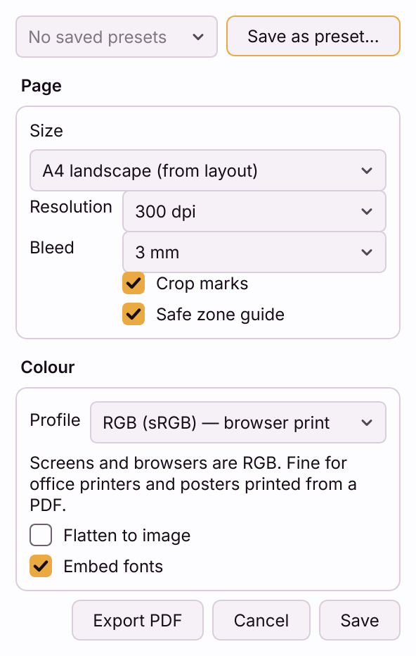

# Printing a cartograph

A cartograph knows its own page size. Open it in a browser, print, and an A3
layout comes out as A3 - no QGIS, no re-export. This page covers printing it
yourself, sending it to someone who will, and preparing it for a print shop.

## Print from the browser

Open the cartograph and print with **Ctrl+P** (**Cmd+P** on macOS), or use
**Share → Export PDF...** in the plugin, which opens the cartograph and its
print dialog for you. To get a PDF, choose **Save as PDF** as the printer.

- **Chrome, Edge, Brave, Opera and other Chromium-based browsers** print at
  the page's true size. Leave the margins at their default; the page sets its
  own.
- **Firefox and Safari** ignore the page size a web page asks for and print on
  whatever paper is selected in the print dialog, scaled to fit. Choose the
  matching paper size there, or print from a Chromium-based browser. This is a
  browser limitation, not something the file can fix.

Text stays text in the PDF - selectable and searchable - and the legend, scale
bar, north arrow and grid stay sharp vector shapes.

**For a page with live frames, print with Export PDF, not Ctrl+P.** A live
map is drawn by the graphics card, and browsers print such a map blank or at
screen resolution. Export PDF opens the cartograph with `?print=1` added to
its address: the page waits until every map has finished drawing, swaps each
live map for an image rendered at print resolution, and only then opens the
print dialog. The browser's own **Ctrl+P** does none of that - the print
dialog opens at once, before an image could be made.

Anyone can do the same without the plugin: add `?print=1` to the end of the
cartograph's address in the browser (`…/Parcel-survey.html?print=1`) and
press Enter.

A page of only static frames prints the same either way.

## Export PNG

**Share → Export PNG...** opens the cartograph, which renders the page as a
**300 dpi** PNG and downloads it through your browser - into your Downloads
folder, as with any download. Live frames are re-rendered at that resolution,
not enlarged from the screen.

For an atlas, see [exporting every page](cartograph-atlas.md#exporting-every-page).

## Print settings

**Share → Print settings...** sets up the page for print. The settings are
stored **per layout**, with the project, and written into the cartograph on
every save - so a cartograph you send someone prints with them too.

Until you save them once, a cartograph has none of these: no bleed, no marks,
the layout's own page size. The dialog opens with a print-shop starting point
of 300 dpi, a 3 mm bleed, crop marks and the safe-zone guide.

### Page

- **Size** - the layout's own page (*A4 landscape (from layout)*), a preset
  (A5 to A0, Letter or Legal, portrait or landscape) or **Custom...** in
  millimetres. Items keep their positions measured from the top-left corner,
  so a page smaller than the layout cuts off whatever falls outside it.
- **Resolution** - **150**, **300** or **600 dpi**: how finely live frames are
  rendered when the page is printed, and the resolution of a PDF made by QGIS.
  A static frame keeps the DPI set for it in Map frames.
- **Bleed** - **None**, **3 mm**, **5 mm** or **1/8 in**. The printed sheet
  grows by that much on every side, so a slightly-off cut shows no white edge:
  A3 with a 3 mm bleed prints on a 303 × 426 mm sheet. Items keep their
  positions from the trim corner.
- **Crop marks** - trim marks at the four corners, drawn in the bleed. They
  need a bleed to sit in, so the box is greyed out with **None**.
- **Safe zone guide** - a line 5 mm inside the trim, on screen only, showing
  where text risks being cut. It is never printed and never exported.

### Colour

- **Profile**:
  - **RGB (sRGB) — browser print** - the default. Screens and browsers are RGB;
    fine for office printers, and for posters printed from a PDF.
  - **CMYK PDF/X-4 — via QGIS** - see below.
  - **Printer ICC profile...** - pick the print shop's `.icc` or `.icm` file;
    see below.
- **Flatten to image** - prints one picture instead of text, shapes and
  images. Text stops being selectable, but some print shops' machines handle
  it better. Off by default.
- **Embed fonts** - for a PDF made by QGIS: off turns text into outlines.

### Buttons

- **Export PDF** - saves the settings and exports straight away.
- **Save** - keeps the settings for this layout without exporting.
- **Save as preset...** - keeps them under a name, for every project. Pick a
  saved one from the list at the top.

## CMYK and print-shop profiles

A browser can only print RGB. A print shop that asks for **CMYK**, a
**PDF/X-4** file or their **ICC profile** needs a PDF that QGIS makes, and the
plugin has QGIS make it from the same Print settings:

1. Choose **CMYK PDF/X-4 — via QGIS** or **Printer ICC profile...**.
2. Press **Export PDF** and choose where to save.

QGIS prints a copy of your print layout - page 1, grown by the bleed, with the
crop marks drawn in - using the chosen colour model, and puts your project's
colour settings back afterwards. Your layout itself is never changed.

The **Title** from the Cartograph tab is applied to that copy, so a label that
reads the project title and the PDF's own title match the browser's. The page
**attribution** and **theme** are browser features. When you have set either,
Export PDF first explains that the QGIS PDF will not carry it and offers
**Continue**, **Use browser RGB export instead** (RGB only), **Add attribution
to the layout** (a small label along the foot of page 1, one Undo step in the
layout designer) or **Cancel**. What you accepted is not repeated after the
export.

With **CMYK**, the PDF is PDF/X-4 when the project has a CMYK profile set in
**Project Properties → Styles**; without one you get CMYK colours but no output
profile, and the plugin says so. With an **ICC profile** (ask the shop - FOGRA39
is common in Europe, GRACoL in North America), it is embedded as the PDF's
output intent.

Both choices are **greyed out, with the reason in their tooltip**, when:

- QGIS is older than 3.40, or **built on a Qt older than 6.8** - QGIS 3 LTR
  builds are Qt 5, and many QGIS installs are not yet on Qt 6.8. The tooltip
  names the version you have.
- **Any frame is live.** QGIS draws the layout, not the browser, so it cannot
  draw a live frame as the cartograph shows it. Set every frame to **Static**
  in Map frames, on the Layout tab.

A saved CMYK choice that this QGIS cannot honour shows as RGB, with a line
saying why - it is never swapped silently.

Because QGIS prints the layout, the Page section's **Title** and **Theme**
do not apply to a CMYK or ICC PDF; the layout's own text and colours do.

## Printing an atlas

**Export PDF** and Ctrl+P print the page on screen - one page of the atlas.
The pager at the foot of the sheet is never printed.

For the whole series, use **Print all pages...** on the
[Atlas tab](cartograph-atlas.md#exporting-and-printing-every-page): every page
is rendered and laid out for one print job, and **Save as PDF** gives one
multi-page PDF, each page at its true size in a Chromium-based browser. The
pages are images rendered at 200 dpi, so text in that PDF is not selectable.
**Export all pages (PNG, ZIP)...** beside it gives every page as a 300 dpi PNG
instead.

## Sending it to someone who will print it

- Send the cartograph itself - see
  [sharing a cartograph](share-qgis-print-layout-without-qgis.md).
- Tell them to print from Chrome or Edge, or to pick the right paper size in
  Firefox and Safari.
- If the page has live frames, consider making them static first: a static
  page prints the same however it is printed, and needs no graphics support.
- For a print shop, send the PDF from **Export PDF**, not the HTML.
