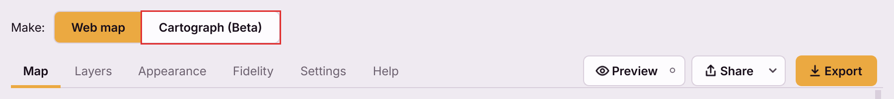

# The dialog, tab by tab

Open it with **Web → QGIS2WebMap by NIKA → Create web map**, the toolbar
button, or **Ctrl+Alt+W** (**Cmd+Alt+W** on macOS). **Ctrl+Alt+C**
(**Cmd+Alt+C**) opens it on Cartograph (Beta) instead. To change either
shortcut, search for *Create web map* or *Create cartograph* in
**Settings → Keyboard Shortcuts**.

The dialog is **non-modal**: QGIS stays usable behind it. Reorder, rename or
restyle layers in the Layers panel and the plugin follows immediately. There is
no refresh button because there is nothing to refresh.

Four tabs - **Map**, **Layers**, **Appearance** and **Fidelity** - under a
[header](#the-header) that stays on screen whichever tab you are on, with the
[fidelity strip](#the-fidelity-strip) at the foot.

The dialog opens at 1152 × 768 pixels, or smaller to fit your screen. Every
control can be reached with the keyboard, and the one with keyboard focus
always shows a visible outline. In Arabic the whole dialog is laid out right
to left.

Settings are remembered **per project**, stored in the `.qgz` alongside it, so
they travel with the project rather than following you between projects. The
exceptions are remembered per machine instead, because they are habits rather
than properties of a map: the last folder you exported to, and the choices on
the [Settings](#settings) page, which gathers the per-machine ones you can
change.

---

## Web map or Cartograph

The dialog's title, at the top left, says what it makes:
**Web map ▾**. Click it for a menu of the two outputs, each with a
one-line description:

- **Web map** - an interactive map to pan, zoom and click. It covers the
  whole project, and is what the rest of this page describes.
- **Cartograph** (Beta) - a print layout with live maps, to read or print, as
  one HTML page. The tabs give way to the layout's page and a panel beside
  it, and the header's actions change. See
  [the Cartograph dialog, tab by tab](cartograph-dialog.md).

**Ctrl+Alt+W** opens the dialog on Web map and **Ctrl+Alt+C** on Cartograph.
The layer settings and the checks are shared: the cartograph shows the same
Layers list, and its Checks tab is this page's Fidelity report for the
cartograph. Switching back and forth loses nothing you typed on either side,
and the choice is remembered with the project.

---

## Map

Everything about the map as a whole, and the one place the exported title is set.

### Map name

The first field in the dialog, and the **only** place the exported title comes
from. It is shown on the map and in the browser tab.

Leave it blank to use the project title. The field is prefilled from
**Project Properties → General**, falling back to the project file name and then
to `Untitled map`, and typing here **does not write back to the project** —
exporting a map should not quietly edit your project's metadata.

Setting a name here does not by itself draw it on the map. That is the
**Map title** switch on the [Appearance tab](#caption), which is off by default.

### Export

Choose **what to make** and **where it goes**, then press **Export** at the
top right of the dialog.

**Export as:**

- **Standalone HTML** — one file that opens by double-clicking, with all of your
  data inside it. The default.
- **Share ZIP** — the same map zipped, with a short README. Use it when a mail
  filter blocks `.html` attachments.
- **Folder** — `index.html`, `onlymap.js` and a README side by side, to copy to a
  web server. A folder has to be served; it does not open by double-clicking.
  Exporting again into the same folder replaces the files the plugin wrote
  (it keeps a small `.qgis2webmap-export.json` list of them) and removes the
  ones the map no longer has, such as a raster you took out; files you added
  yourself are left alone.

**Save to** is where the export is written. A new map starts with a place
already filled in: **Documents/QGIS2WebMap/Web maps**, named after the map -
`Peaks.html` for a map called *Peaks*. The folder is created when you press
Export, and if a file of that name is already there, the new one gets a
number: `Peaks (2).html`. Type another path or press **Choose...** to change
it; to use another folder for every new map, see [Settings](#settings).
Switching the type keeps the name: `peaks.html` becomes `peaks.zip` or a
`peaks` folder. Pressing Export writes there without asking again. A failed
or cancelled export leaves the file that was already there as it was.

For a Standalone HTML export, a line underneath gives measured size advice: how
large your map's data actually is, and when the file would become slow to open
or awkward to email.

A second line says what is on disk:

| It says | It means |
|---|---|
| *Choose where to save, then press Export.* | The field was cleared. Nothing has been written |
| *Not written yet.* | The path is set; nothing is there until you export |
| *Last written 20 min ago* | Written earlier. Export again if the project has moved on |

Both the type and the place are saved with the project.

### Basemap

A backdrop drawn behind your data: **None**, OpenStreetMap, Positron, Dark
Matter, Voyager, Liberty or Bright.

**None is the default, and it is the only choice that keeps the export offline.**
Every other option means the recipient's browser fetches tiles from that provider
every time they open the map — so the provider sees those requests, including
roughly where the reader is looking. The Fidelity tab names the provider. Nothing else changes: no
identifier travels with the file, the anonymous usage report is the same either
way, and the file is no larger.

**OpenStreetMap only works for maps on a website.** Its tile servers refuse a map
opened straight from a file, so a recipient who double-clicks a Standalone HTML
or Share ZIP export may see "Access blocked" tiles. The dialog warns under the
basemap when you pick it for those types; choose **Liberty** instead - the same
OpenStreetMap data, drawn a little differently - or export as a Folder.

**Let readers switch basemap**, off by default, puts a Basemap panel in the
map's bottom-left corner, with the zoom controls, scale bar and measure tool,
listing every basemap above
but None, with the map's own ticked; a reader picks another to switch to it.
In a Standalone HTML or Share ZIP export it leaves out OpenStreetMap, which
refuses maps opened from a file - unless OpenStreetMap is the basemap you
chose. Each basemap a reader can switch to is another provider their browser
may contact, so the Fidelity tab names every one of them. It needs a basemap
to switch from, so it is greyed out while the basemap is None, and while
**Ground surface** is on, because relief replaces the basemap with imagery
draped over it.

**Ground surface** sits in the same group because it costs the recipient the same
thing. **Flat** is the default; **Global relief** tilts the map so elevation
shows, and fetches terrain tiles to do it. With a basemap chosen too, the
basemap's imagery drapes over the relief — mountains that look like the map,
with your symbology painted onto the slopes. The warning under the control
names every host the relief streams from.

Basemaps needing an API key are deliberately absent. An exported file would have
to carry the key in plain text where every recipient could read it.

### Data

**Open the map on** — where the map is positioned when someone first opens it.
*The data* frames every feature; *the current QGIS view* uses your canvas as it
stands. Either way the reader can pan and zoom anywhere afterwards.

**Export only the features in this view** is a separate decision, and folding the
two together is exactly how you would ship a map missing everything outside your
working extent. This one *removes* data: anything outside the current QGIS view
is left out of the file. It is the practical way to bring a very large layer
under the free plan's 25,000-feature limit, and the Fidelity tab reports how many
features each layer loses.

**Coordinate precision** — the only setting in the dialog that throws data away,
which is why it defaults to *Maintain full precision*. Rounding coordinates makes
the file smaller and cannot be undone. Six decimal places is about 0.1 m at the
equator. When you choose it, the fidelity report says so.

### The summary line

At the bottom of the tab, a plain sentence saying what the map file will
contain, given every choice above. It is a consequence, not a setting.

---

## Layers

One list, driven by the QGIS Layers panel, bottom layer first — the same order
the map draws in.

The **Search layers and fields** box above the list filters it as you type, by layer name or field name (case and accents ignored). A matching field opens its layer; **Esc** or the clear button brings the list back as it was, and no tick or choice changes.

### The three columns

The **i** at the bottom right of the tab sums these up.

| Column | Ticked | Unticked |
|---|---|---|
| **Include** | The layer is in the map | The layer is left out, and its data is never written to the file |
| **Popups** | Clicking a feature shows its attributes | Clicking does nothing, and the attribute values are **not written to the file** |
| **Labels** | The text you set in QGIS is drawn beside features | No text. The features themselves are unaffected |

Two of these matter beyond tidiness:

- Unticking **Popups** is how you keep attribute data out of a map you are
  sending someone. The values are not hidden — they never reach the file, so
  there is nothing to recover by opening it in a text editor.
  This includes a GeoPackage's key column: left out of the file, the features
  are numbered 1, 2, 3 instead of carrying the key as their id.
- Unticking **Include** or **Popups** makes the file smaller, which matters
  because the map file carries all of its data inside it.

Unticking any box affects that layer only. The map still works, with less on it.

### Per-field popup settings

Expand a layer to list its fields. Each gets its own setting:

| Setting | Effect |
|---|---|
| **Value only, no label** | The value with no field name beside it |
| **Label beside value — always show** | Field name and value on one line, even when empty |
| **Label beside value — only if it has data** | The same, but the row disappears when the value is empty |
| **Label above value — always show** | Field name on its own line above the value |
| **Label above value — only if it has data** | The same, but hidden when empty |
| **Do not show this field** | The field's values are **removed from the file**, exactly as unticking Popups does for the whole layer |

**One exception, and it is deliberate.** A field the map *draws* with — the one a
categorised or graduated style is based on, the one labels read their text from,
an extrusion height, or the one the layer is filtered by — stays in the file
even when you hide it. Removing it would conceal nothing, since it is visible on
the map either way; it would only break the drawing.

### Filter by

The **This layer only** row of an expanded vector layer has **Filter by**,
on *none* to start. Choose one of the layer's fields and the map gets a panel,
top left under the layer switcher, headed by the field's alias, that filters
the layer by it:

- a **number** or a **date** gets a slider with a low and a high end, which
  start at the smallest and largest value, so the map opens showing every
  feature;
- **text** gets a tick box for each of its values, with how many features have
  it, all ticked. A field with more than 50 different values is refused — a
  list that long is not a filter — and the Fidelity tab says so.

Only those three kinds of field are offered. A feature with no value in the
field is hidden while the layer has a filter, since the filter keeps features
by their value; the Fidelity tab counts them. A filtered layer's points are not
merged into count bubbles, because the map's filter cannot count the bubbles
again, and its labels stay on for features the filter hides. Cartograph frames
carry no filter panel.

### Set every field to … Apply to all layers

A bulk action for the tedium of setting a dozen layers by hand. It is a button
rather than a live combo because it overwrites every field in every layer and
should not fire on a stray scroll.

### The list follows QGIS

Reorder, rename, add, remove, group or hide a layer in the QGIS Layers panel and
this list rebuilds. Per-layer settings survive that rebuild — they are keyed to
the layer, not to the row — and settings for a removed layer are kept, so undoing
the removal in QGIS restores its configuration too.

---

## Appearance

How the map looks to the reader. **Everything here is on by default**: an
exported map should be useful without configuring anything.

### Map controls

Five switches — **Legend**, **Layer switcher**, **Zoom controls**, **Scale bar**,
**Measure tool**. Untick one to leave that control off the exported map.

The **measure tool** lets whoever opens the map measure on it. They pick
**Distance** or **Area**, click points on the map, and read the
total. A distance is two points: the second click ends it, the line and its
total stay on the map, and clicks go back to the map - popups, panning - until
**Distance** is pressed again for a new one. An area takes as many
points as needed and closes on **Ctrl + click** (**Cmd + click** on a Mac),
which places its last point; a double-click, a double-tap on a touch screen or
**Enter** close it too. While an area is being drawn a small hint above the
tool says so. **Clear** removes the measurement, and clicking a pressed button
again ends measuring. While it is measuring, a click places a point rather
than opening a popup. Distances and areas are measured on the ground, whatever
CRS the project uses.
It sits in the bottom-left corner, which narrows upward like a pyramid: the
widest control at the bottom, just above OnlyMap's licence notice - the measure
tool, then the basemap panel, the scale bar and the zoom controls on top. On a
window too short for the corner its controls fold into a drawer, as they do on
a narrow one, rather than reach the panels in the top-left corner.

Beside **Measure tool**, while it or **Scale bar** is ticked, **Metric**,
**Imperial** and **Nautical** choose the units both read in (with Nautical,
measured areas stay metric). Metric is the default. The choice is saved with
the project, and the exported map has no units control of its own: it
measures, and its scale bar reads, in what you chose.

Beside **Legend** and **Layer switcher**, while each is ticked, two boxes set
that panel's width and height in pixels — width 140 to 600, height 100 to
1000; a number outside that is brought into it. Left on **Auto**, the panel is
as it has always been: as wide as its contents and as tall as them, up to half
the map, scrolling inside past that. A height the contents do not fill leaves
the panel that tall, and longer contents scroll inside it. Whatever is set,
the panel stays on the map: on a smaller window it is at most the map's width
and height, so the page never scrolls. A WMS or WMTS layer's legend picture
takes the width of a legend whose width is set, and scrolls with a legend
whose height is set. The zoom controls, scale bar and measure tool have fixed
sizes; **Size** under [Control colours](#control-colours) scales them all.

The layer switcher is the one exception to that. It only appears when the map
has more than one thing to switch between, so a map with a single unlabelled
layer does not get one however this is set — there would be nothing in it but a
single ticked box. Turning labels on counts: a labelled layer travels with its
labels as a second entry, which you can then show and hide on their own.

### Caption

Both off by default, because an unwanted caption drawn over someone's map is
worse than a missing one.

- **Map title** draws the [map name](#map-name) over the map. The legend drops
  its own heading while this is on, so the title never appears twice.
- **Project description** draws the abstract from
  **Project Properties → Metadata**. Nothing appears if the project has none.
- **Position** places the caption. All four corners already hold controls —
  switcher (and any filter panels and WMS-T time sliders) top left, legend
  top right, zoom, scale, measure tool and basemap
  panel bottom left, credit bottom right — so the two centre positions are the only
  genuinely clear space, and they are listed first.

### Control colours

**Background** and **Text and icons** apply to the legend, layer switcher, zoom
controls, scale bar and measure tool. Both start unset, meaning *use the map's own styling*;
leave them that way and a default export is unchanged.

**Size** scales the legend, layer switcher, zoom controls, scale bar, measure
tool and title together — Small through to *Largest, for presentations and big screens*. The
credit stays fixed, so attribution cannot be shrunk out of legibility. On a
narrow screen the controls fold into drawers; above Normal they fold on a
proportionally wider map, so they keep the room they have at Normal, and in a
drawer they are at their Normal size.

### Behaviour

**Open popups on hover instead of click** replaces click rather than adding to
it. Bound together, a click on an already-open popup appears to do nothing.

**Highlight under the cursor** is the colour shown when the reader's pointer is
over a feature. Keep some transparency — a solid colour hides whatever the
feature is drawn on top of. Leave it unset for the default, a see-through white.

---

## Fidelity

The reason this plugin exists. It answers one question — *what does my recipient
not get?* — **before** you export, not after.

The report builds when you open the tab, reading every feature of every layer, so
it takes a moment on a large project and shows a progress bar while it does.
Preview and Export read the project too, and refresh the report as they go.

One line at the top sums it up — `5 layers · 1 needs attention · 10 things
change`. A layer *needs attention* when something about it is Blocked or Not
exported. Below it the report is grouped, problems first:

- **Whole map** — settings that belong to no one layer: the basemap, relief,
  where the map opens, its title. Its own line describes the whole map: how
  many layers and features, roughly how much data, the output, where the map
  opens and its basemap.
- **One group per layer**, the layers that lose something before the layers that
  are only changed. A layer that comes through exactly is a single `✓ exact`
  line. Each layer's own line says what it is: its geometry and feature count,
  how it is styled and on which field, its labels, how many fields its popups
  show and how many go into the file, the zooms it shows at, and how much data
  it adds.
- Every row has its whole sentence in the **Detail** column.
- Rows saying the same thing about several classes of one layer are merged into
  one, with the number of classes. Expand it to see each class.

Select a row to see it in the pane below the list, with the classes it applies
to. Where the fix is in this dialog, the pane has a button that goes there:
**Show in Layers** for a layer, **Go to Map tab** for the basemap and the other
map settings.

**Filter**, beside the summary, chooses what the list shows — one tick per
verdict, each with how many rows it has, and one per topic: **Symbology**,
**Labels**, **Popups & fields**, **Data** and **Map settings**. The menu stays
open while you tick, and the button says how many rows are folded away. The search box finds rows by any word
in them, or a layer by its name or by what it is ("polygons", "labels from").
**Kept** rows are hidden by default so the changes stand out; tick **Kept** to
bring them back. Your choices are remembered. Filtering only folds rows away:
the counts at the top and in the strip are always about the whole report.

When something changes after a check — a layer ticked or unticked, the map
renamed, a layer added, restyled or edited and saved in QGIS — the report is
marked **Out of date** rather than going on looking current. **Check again**
refreshes it.

| Verdict | Meaning |
|---|---|
| **Blocked** | Cannot be carried into the map at all — usually a layer QGIS could not load. Export still works, but asks first and names what will be missing |
| **Not exported** | Cannot be represented, and was left out. The map is still produced |
| **Changed** | Exported, but approximated — the detail says how |
| **Rasterised** | Drawn into the map as an image: markers QGIS draws itself, or a raster's colours baked into its pixels. It looks as it does in QGIS, but it is a picture now |
| **Kept** | Survives exactly as set in QGIS |

If the check itself fails, the tab says so and why. That is not a verdict: it
says nothing about your map, only that the check did not finish.

Worth reading before you send a map on.

---

## Settings

The **Settings** icon (sliders) at the right of the header opens this page in
place of the tabs; the back arrow, or the icon again, returns to them. It
holds things that are true of every project, rather than of one map:

- **NIKA account** — who this copy of QGIS is signed in as. Publishing to NIKA
  needs an account; exporting a file never does.
- **Language** — *Follow QGIS* (the default), English, or one of Português
  (Brasil), 中文（简体）, हिन्दी, Español, العربية and Français. English is built
  in; the others are a small download the first time you pick one, checked
  against the copy released with this version. *Follow QGIS* uses the language
  QGIS is set to when it is one of these, and otherwise English. When QGIS is
  in one of them and its pack is not downloaded yet, a bar at the top of the
  dialog offers it — nothing is downloaded until you press it. Switching
  reopens the dialog in the new language; QGIS does not need a restart.
- **Appearance** — the dialog's theme: Follow QGIS, Light or Dark.
- **Saving** — **Save new maps in**: the folder new maps start in,
  `Documents/QGIS2WebMap` unless you change it. Web maps go in its
  `Web maps` folder and cartographs in its `Cartographs` folder. **Change...**
  picks another folder, and **Use Documents** goes back to the default. Maps
  already saved stay where they are.
- **About** — the plugin version and the OnlyMap runtime it is pinned to.

---

## Help

The **Help** icon (?) beside Settings opens the same guides you are reading
now, bundled into the plugin and rendered offline, in place of the tabs. The
back arrow returns to them. **Open the full documentation** opens this site in
your browser, and **Join the community** opens the NIKA Discord.

---

## The fidelity strip

Under the tabs, always visible, whichever tab you are on:

- `3 things change on export.` — or
- `1 layer cannot be exported.` — or
- nothing at all.

**Nothing at all is the good case.** A permanent "0 things change" trains people
to stop reading it, so a clean export says nothing and the absence is the
message. **What changes?** jumps to the Fidelity tab.

---

## The header

### Preview, Share and Export

All three sit at the **top right of the dialog**, beside the title, so they
are within reach whichever tab you are reading. The **Settings** and **Help**
icons come after them.

**Preview** builds the map and opens it in your default browser. Nothing else
in the plugin opens a browser, and a preview never writes your map file - only
Export does.

Beside Preview is the labelled **Live** switch. **Off**, Preview opens the map
as it is now - press it again after changing something. **On**, the preview
keeps updating: Preview serves the map from your own machine and the browser
tab updates by itself as you change settings, keeping your position on the
map. While that runs the button reads **Stop live**; press it, or close the
tab, to stop. The switch stays on - it is a habit, remembered on this machine -
so the next press starts a live preview again.

If a live preview cannot be served — a firewall, a locked-down machine — it
opens as a file instead and tells you so.

**Export** writes the map in the type and place chosen on the Map tab. It is
the filled button, last in the row, because it is what the plugin is for.

**Share** is everything else you might do with the finished map. Pressing it
opens the menu:

| Row | What it does |
|---|---|
| **Copy file path** | Puts the map file's path on the clipboard |
| **Show in file manager** (**Reveal in Finder** on macOS, **Show in Explorer** on Windows) | Opens the folder the map file is in |
| **NIKA hosting: Join NIKA hosting waitlist ↗** | Hosting is not live yet; this opens a short waitlist form in your browser. It does not publish the map |
| **Ask on Discord** | Opens the QGIS2WebMap channel on the NIKA Discord |

**Copy file path and Show in file manager need a Save to path.** A new map
has one from the start; if you clear the field on the Map tab they are greyed
out, and each says so if you hover it. The other rows are always available.

**Neither writes the map.** Copy file path only copies the path, and Show in
file manager opens the folder straight away - the folder the map will be
written to, if it is not written yet. Export first if the project has moved
on since the last export.

Preview, Export and Share's file rows are greyed out when there is no map to
produce, with the reason in the bar at the foot of the dialog rather than a
silent refusal:

| The reason says | Fix |
|---|---|
| *Add a vector or raster layer to the project to export.* | The project has no exportable layer |
| *Tick at least one layer to include.* | Everything is unticked on the Layers tab |

A **Blocked** item does not grey them out: Export asks first, naming what the
map will be missing, and the Fidelity tab says why.

### Progress and Cancel

A bar appears only while something is running, naming the layer it is on, with
**Cancel** beside it. Its appearance is the signal that work is happening rather
than that the plugin has hung. One job runs at a time: pressing Export twice does
not export twice.

The bar also follows raster conversion, the slow part of a map with imagery.
**Cancel** stops the job and leaves the file you already had untouched, right up
to the moment the bar reads *Saving the map...*. From there the file is being put
in place, Cancel is greyed out, and the export finishes.

---

## Next

- [Your first export](first-export.md) — the same ground as a walkthrough
- [What gets exported](supported-features.md) — what each verdict is based on
- [Sharing a map](sharing.md) — which Share row to reach for, and why
- [Troubleshooting](troubleshooting.md) — when a control is not doing what this
  page says
