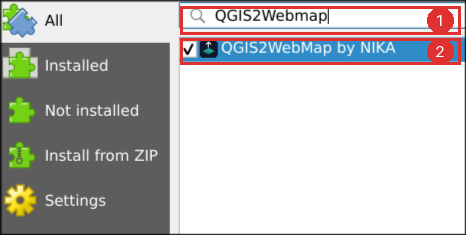
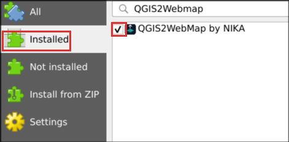

# Troubleshooting

Every entry here is a real reported failure, with what causes it and what to do.
If yours is not listed, the QGIS **Log Messages** panel usually says why: open
**View → Panels → Log Messages** and read the `QGIS2WebMap` tab.

**Not listed here?** Ask in the QGIS2WebMap help channel on
[our Discord](https://discord.gg/RujwMpednf). Problems, suggestions and bug
reports all go there, and you do not need a GitHub account to post.

## Installing

### Searching the plugin list finds nothing

1. Make sure **All** is selected on the left of the Manage and Install Plugins
   window, not **Installed**.

   

2. Check the spelling. It is one word: `QGIS2WebMap`. Searching `OnlyMap` also
   finds it.
3. If the whole list is empty, QGIS cannot reach the plugin repository — often a
   workplace firewall. Check **Settings → Options → Network** for a proxy, then
   see [installing from a file](installation.md#if-your-organisation-blocks-the-plugin-repository).

### It installed, but there is no Web menu entry

1. **Plugins → Manage and Install Plugins → Installed** — confirm
   **QGIS2WebMap by NIKA** is there and its box is ticked.
2. If it is there but unticked, tick it. The menu entry and toolbar button
   appear straight away.

   

3. If it is ticked and still missing, open **View → Panels → Log Messages** and
   read the `QGIS2WebMap` tab for an error.

### It installs but errors on an older QGIS

The plugin requires **QGIS 3.44 or newer**. Earlier versions are not supported —
not as a policy but as a measured fact: they fail. QGIS 4 is supported.

Check with **Help → About**.

### QGIS closed while I was using it

That is a bug, not a normal outcome. The plugin never closes QGIS, and the only
thing it ever installs is the OnlyMap runtime, once, after asking. Please
[report it](https://github.com/NikaGeospatial/qgis2webmap/issues) with the tail
of the Log Messages panel.

## The runtime download

### It asks to download something. Is that expected?

Yes, once per computer. The **OnlyMap runtime** is the code that draws the map in
a browser, and it is built into every map you export — which is exactly what lets
someone open your map with nothing installed. It is a separate commercial product
with its own licence, which is why it is fetched rather than bundled into this
GPL plugin, and why you are shown the licence first.

About 6.1 MB. After that, everything works offline, and exporting itself never
touches the network - except to read a layer QGIS itself reads from the web:
a web service layer's features, or the header of a raster at a web address
when GDAL no longer holds it. See [privacy](privacy.md) for what those requests
do and do not send.

### The download fails

The download uses QGIS's own network settings, so check
**Settings → Options → Network** first — a proxy configured there is used
automatically.

If outside downloads are blocked entirely, install the runtime by hand:

1. On a machine with access, download the package from
   [npm](https://www.npmjs.com/package/@nika-js/onlymap) and unpack it.
2. Copy the `dist` folder — you need `onlymap.standalone.js` and `onlymapjs.css`.
   For maps with PMTiles archives or vector tile layers, add `dist/mvt-worker.js`
   from [`@loaders.gl/mvt`](https://www.npmjs.com/package/@loaders.gl/mvt)
   4.4.3 to the same folder, or those maps load it from unpkg.com and draw only
   online.
3. On the offline machine, set the environment variable `ONLYMAP_RUNTIME_DIR` to
   that folder **before starting QGIS**.

The plugin uses a runtime it finds that way and never asks to download.

### The Processing algorithm stops immediately on a new machine

Expected, and it says so. *Export to OnlyMap web map* cannot show you a licence —
there is nobody to show it to during a batch run — so on a computer that has
never installed the runtime it refuses rather than downloading silently.

Export once from **Web → QGIS2WebMap by NIKA** and the algorithm works from then
on.

## Exporting

### Export is greyed out

The reason is printed at the foot of the dialog. It is one of two:

| The reason says | What to do |
|---|---|
| *Add a vector or raster layer to the project to export.* | The project has no layers. One whose layers the web map cannot draw (only ArcGIS map services or attribute tables, say) is not greyed out: its export stops with *There are no layers to export* |
| *Tick at least one layer to include.* | Everything is unticked in the **Include** column on the Layers tab |

Export and Preview also go dark while a job is running, and come back when it
finishes. A **Blocked** item on the **Fidelity** tab does not grey Export out:
pressing it asks first, naming what the map will be missing.

### Extruded polygons export flat

The Fidelity tab's **Height** row says the layer exports flat even though
Layer Properties → 3D View sets an extrusion. This happens when the project
was opened *before* the plugin was installed or enabled in that session:
QGIS only registers 3D renderers once something asks for them, and a project
loaded earlier has already discarded its 3D settings. Re-open the project
(the plugin registers 3D support when it loads) and export again.

### Export fails with "too many values to unpack"

Affects 0.1.4 and earlier. It happens when a **polygon layer stores elevation in
its geometry** and that layer has labelling switched on. In QGIS, open Layer
Properties → Information: if the geometry reads *Polygon (Z)* or
*MultiPolygon (Z)* rather than plain *Polygon*, this is the layer. Data
digitised with **Add Z dimension** ticked, shapes draped over a DEM, and
anything imported from CityGML, IFC or a Z-enabled GeoPackage all arrive this
way.

Note this is not the same as extruded polygons. Extrusion reads a height from an
*attribute* and leaves the geometry flat, and those layers were never affected.

Fixed in 0.2.0: update the plugin. If you cannot, either switch labelling off
for that layer, or give it flat geometry — **Processing Toolbox → Vector geometry → Drop
M/Z values**, which writes a new layer with the elevation removed. Dropping Z
does not affect extrusion, because extrusion never reads the geometry's height.

### The Fidelity tab takes a long time to fill

It reads every feature of every layer, so a large project takes a while. The
progress bar names the layer it is on. It runs on a background thread — the
window stays usable, and **Cancel** stops it. Layer settings and styling are
read first, on the main thread, which is a brief pause rather than a freeze.

### Nothing happens when I press Export twice

By design. One job runs at a time, and both buttons go dark while it runs, so a
second press cannot start a second export.

### The exported file is enormous

Standalone HTML writes every feature into the file itself. That is what makes it
self-contained, and it is inherent to the format — a map with 20 MB of data
produces a file of at least 20 MB.

In order of how much they save:

1. Untick **Popups** on layers whose attributes nobody needs. Those values leave
   the file entirely.
2. Untick **Include** on layers that are not carrying their weight.
3. On the Map tab, tick **Export only the features in this view** to drop
   everything outside your current extent.
4. Set **Coordinate precision** to 6 decimal places. This is irreversible; six
   places is about 0.1 m at the equator.
5. Switch to **Share ZIP**, which compresses the same map.

## Opening and sharing

### The map is blank, or shows a message about JavaScript

You are looking at it somewhere that does not run JavaScript — an email client's
preview pane, a file manager's preview, a chat app's inline viewer. The message
is deliberate; a blank window would be worse. Save the file and open it in a
browser.

### Double-clicking the Folder export does not work

Not in Chrome, Edge or Safari, which refuse to load the runtime from a separate
file on a `file://` page, and the page says so: it has to be served from a web
server. Firefox loads it and draws the map. The Folder mode exists for uploading to a web server; to try one on
your own computer, run `npx http-server` inside the folder and open the address
it prints.

Use **Standalone HTML** for anything that has to open off a disk.

### The map never arrived / the attachment was stripped

Many mail providers and corporate filters quarantine or remove `.html`
attachments, because HTML is a common phishing vector. This is the single most
common delivery failure.

Export as **Share ZIP** instead. A zip usually passes filters a bare `.html` does
not, and it carries a short README telling the recipient how to open it.

### The recipient says features are missing

Check the **Fidelity** tab against that layer. The usual causes:

- **Export only the features in this view** was ticked, and the missing features
  were outside your QGIS extent at export time.
- The layer is unticked in **Include**.
- The map is being served from a real domain and is over the free plan's limits —
  see below.

## Hosted maps

None of this applies to a file someone double-clicks, emails, or opens from
`localhost`. Those draw everything, with no licence key.

### Layers past the fifth do not render, or a layer is truncated

The OnlyMap free plan allows **5 layers per map** and **25,000 features per
layer**, and those limits apply only to a page served over `http(s)` from a real
domain. A layer past 25,000 features is truncated to its first 25,000 while still
looking complete, which is why the Fidelity tab names every layer over a limit
before you host.

An OnlyMap licence key lifts the limits and removes the on-map badge. Supply it
through the `ONLYMAP_LICENSE_KEY` environment variable or the Processing
algorithm's licence parameter. Lifted limits are a technical convenience and not
a licence grant — commercial use needs a key either way. See
[size limits on the free plan](supported-features.md#size-limits-on-the-free-plan).

### The map is blank on my own site but fine locally

Your site's **Content Security Policy**. The map's styling is driven by
expressions the runtime evaluates at draw time, and the page starts the map
with scripts of its own, so a policy without `'unsafe-eval'`,
`'unsafe-inline'` and `blob:` in `script-src` stops it rendering — not partly,
entirely. See
[hosting](hosting.md#if-your-site-sets-a-content-security-policy).

### A WMS or WMTS layer is empty in the map

The rest of the map draws, but the service's layer stays blank. The map asks
the service for its images itself, from the reader's browser. The browser's
developer tools (Console) show a refused or failed request, and the map page
reports the cause on its `om-validation-error` event. Common causes:

- **The service is on `http://` and the map is put on an `https://` website.**
  Chrome, Edge and Safari block it (Firefox may still show its tiles as plain
  pictures),
  unless the service also answers on `https://`. The Fidelity tab says so for
  any layer on `http://`, and the map's notice names the layer and the reason.
  Only the service's provider can change that; a map opened from a file or in
  **Preview in browser** is not affected.
- **The service answers with an error** - a WMS error message instead of a
  picture, or an HTTP error such as 404 - often because the layer name, style
  or time it is asked for no longer exists. The event quotes it.
- **The service does not allow web pages to read its images (CORS), and
  its pictures are warped into place** - a WMS asked in a coordinate system
  other than Web Mercator, a WMTS on a national grid, or any such layer in a
  cartograph frame drawn in another projection. The service must send an
  `Access-Control-Allow-Origin` header (`*` for a map opened from a file);
  only its provider can change that.
- **The coordinate system could not be looked up.** A WMS asked in a
  coordinate system other than Web Mercator, or a WMTS on a national grid,
  needs that system's definition; for one the map does not carry, the
  reader's browser fetches it from epsg.io (the Fidelity tab says which), so
  the layer stays empty offline or when epsg.io cannot be reached.

Otherwise, a service that does not allow web pages to read its images (no
`Access-Control-Allow-Origin` header, or one that allows only `https://`
sites, as Sachsen-Anhalt's does) is no longer a cause: QGIS is not a web
page, so such a service works there, and the map now shows its Web Mercator
tiles too, as plain pictures. Those sit under every other layer of the map,
whatever the layer order, are hidden while the map is tilted or rotated, and
are left out of pictures the map saves of itself.

### Clicking a WMS layer shows nothing

A click asks the service what is there from the reader's browser, so the
popup stays closed when the service found nothing at that spot, and also:

- **The layer is not identifiable in QGIS** (Project Properties, Data
  Sources), its service names none of its sublayers as answering clicks, or
  it answers only in a form or coordinate system the map cannot use. The
  Fidelity tab's *Clicks on* row says which.
- **The layer is switched off or outside its zoom range**, or a feature
  popup opened for the click instead: that popup is shown, as only one
  popup opens at a time.
- **The service does not allow web pages to read its answers (CORS)**, is
  offline, or answers with an error: the map's notice says "Could not get
  details from" and the layer's name. Only the service's provider can allow
  web pages; a service on `http://` is blocked in a map put on an `https://`
  website. An error message the service sends back is written to the
  browser's developer tools (Console).

### A WMS or WMTS layer's legend shows no picture

The legend lists the layer by name, without the picture QGIS's legend shows.
The reader's browser loads that picture from the service when the map opens,
so it is missing offline, while the service is down, when the service answers
the request with an error, and on a site whose Content Security Policy does
not allow images from the service ([hosting](hosting.md#if-your-site-sets-a-content-security-policy)).
It needs no CORS, so it can show while the layer's tiles stay empty. A
service that gives QGIS neither a LegendURL for the layer's style nor a
GetLegendGraphic request has no picture in QGIS either, and none is exported;
nor is a picture whose address carries an access key or is not a web
(`http` or `https`) address (the Fidelity tab says so). The legend in a
cartograph lists the layer by name in any case, and its Checks tab says so.

### A raster read over the web (a COG) is empty in the map

The rest of the map draws, but the raster stays blank. The map reads the parts
of the file it draws straight from its server, from the reader's browser, so
the server must allow web pages to read it (`Access-Control-Allow-Origin`,
`*` for a map opened from a file) and to ask for parts of it (Range requests:
`Access-Control-Allow-Headers: Range` and
`Access-Control-Expose-Headers: Content-Range`). The browser's developer tools
(Console) show the refused request; only the file's host can allow access. A
file on `http://` is also blocked inside a map put on an `https://` website. If you
cannot change the server, save a local copy (right-click the layer,
**Export > Save As...**) and add the file instead: it is carried inside the map.

### A layer says "Could not load", or a web service layer shows old features

The map asks a live layer's service for what it draws from the reader's
browser. When that fails - the service sends no `Access-Control-Allow-Origin`
header (`*` for a map opened from a file), answers with an error, is an
`http://` service in a map put on an `https://` website, or the reader is offline -
a WFS, OGC API Features or ArcGIS FeatureServer layer exported *live first*
shows the copy of its features carried in the map, as they were when you
exported. A layer with no copy to show (*live only*, or a tile or map service
layer) is named in a small "Could not load" notice in the bottom-left corner,
which goes once the layer loads again. The browser's developer tools (Console)
show the refused request. To send a map that never depends on the service, set
the layer's **Features** to *embedded* on the Layers tab.

### Basemap tiles do not load for the recipient

The tiles come from the provider's servers on every open, so the recipient needs
internet access and an unblocked route to that provider. If you need a map that
works with no connection at all, set **Basemap** to **None** — the default.

## Cartographs

### "Not saved yet", and Preview does nothing

A cartograph is written as soon as a layout is selected - by default into
**Documents/QGIS2WebMap/Cartographs**, whether or not the project has been
saved. Until that first save finishes, the line at the foot of the panel reads
*Not saved yet*, and Preview and the Share menu's file rows wait for the
file. It normally takes a moment.

If it does not save, that line says why:

| It says | What to do |
|---|---|
| *The OnlyMap runtime is needed to save a cartograph. Nothing was written.* | The one-off runtime download was declined or failed. See [the runtime download](#the-runtime-download), then change any setting to try again |
| *Could not save the cartograph: ...* | The folder cannot be written to - a read-only or disconnected drive, say. Press **Change...** at the foot of the panel and pick another place, or choose another folder for new maps in **Settings → Saving** |
| *Could not build the cartograph: ...* | Something in the layout could not be read. The detail is in **View → Panels → Log Messages**, `QGIS2WebMap` tab |

### The Print layout list is empty

The project has no print layouts. Create one from **Project → Layouts → New
Layout** and add a map to it, or press **New from template...** to have
one built. See [one-click layouts](one-click-layout.md).

### An interactive frame is blank in the browser

An interactive frame is drawn by the graphics card through WebGL. When the browser has
WebGL switched off or unavailable - some virtual desktops, remote sessions,
locked-down work machines, old graphics drivers - the frame shows a short
message instead of a map, and the rest of the page draws normally: scale bars,
grids and scale text still use the map's real extent, the map's legend is left
out, and the page still prints. Try another
browser, or turn on hardware acceleration in the browser's settings.

For a page that must work everywhere, set the frame to **Image** in **Map
frames**, on the Layout tab. A page with only image frames needs no WebGL at all. See
[interactive or image frames](live-or-static-frames.md).

### A preview pane shows "This cartograph needs JavaScript"

A cartograph with an interactive frame needs JavaScript to draw its maps, and a mail
client's, chat app's or file manager's preview does not run it - so it shows
that note instead. Save the file and open it in a browser. A cartograph whose
frames are all Image frames also reads in a preview, without JavaScript.

### It prints at the wrong size in Firefox or Safari

Those two browsers ignore the page size a web page sets, and print on the paper
chosen in their print dialog, scaled to fit. Pick the matching paper there, or
print from Chrome, Edge or another Chromium-based browser, which prints at the
true size. See [printing a cartograph](printing-a-cartograph.md).

### An interactive frame prints blank or blurry

Use **Save PDF…** in the plugin: QGIS draws each interactive frame as a static
map of its current view, with no browser. Or set the frame to **Image**, which prints the same however it is
printed.

### The atlas is Blocked: the map is an image

The Checks tab says *This map follows the atlas, but it is an image frame*.
An image frame is one picture, so it would show the same place on every page.
In **Map frames**, on the Layout tab, set the map the atlas controls to **Interactive**. The coverage layer
does not have to be drawn on that map; it only has to still be in the project.
See [atlas cartographs](cartograph-atlas.md).

### CMYK and ICC are greyed out in Print settings

Hover the choice to see why. Two causes:

- **QGIS is built on Qt older than 6.8**, or is older than 3.40. QGIS 3 LTR is
  built on Qt 5, and colour-managed PDFs need Qt 6.8. Use a QGIS 4 build on Qt
  6.8 or newer, or send the print shop an RGB PDF and let them convert it.
- **A frame is Interactive.** CMYK and ICC PDFs are made by QGIS from the layout, and
  QGIS cannot draw an interactive frame as the cartograph shows it. Set every frame to
  **Image** in Map frames, on the Layout tab.

See [CMYK and print-shop profiles](printing-a-cartograph.md#cmyk-and-print-shop-profiles).

### The CMYK PDF is not PDF/X-4

The project has no CMYK colour profile. Set one in **Project Properties →
Styles**, or choose **Printer ICC profile...** in Print settings with the file
your print shop gave you.

### Only page 1 came out

A cartograph is one page per layout; pages 2 and after are marked **Not
exported** on the Checks tab and left out. Make each page its own layout, or use an
[atlas](cartograph-atlas.md) for a page per feature.

## Still stuck

Come to [our Discord](https://discord.gg/RujwMpednf) and use the QGIS2WebMap help
channel. Discuss any problem or suggestion there, and report bugs there too. It
is the quickest way to reach us.

Whichever route you take, the two things that make a report answerable are the
`QGIS2WebMap` tab of the **Log Messages** panel and your QGIS version.

- Discord: [discord.gg/RujwMpednf](https://discord.gg/RujwMpednf)
- [Open a GitHub issue](https://github.com/NikaGeospatial/qgis2webmap/issues)
- Email [support@nikaplanet.com](mailto:support@nikaplanet.com)
